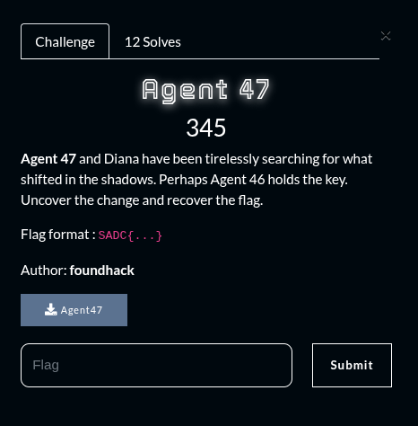
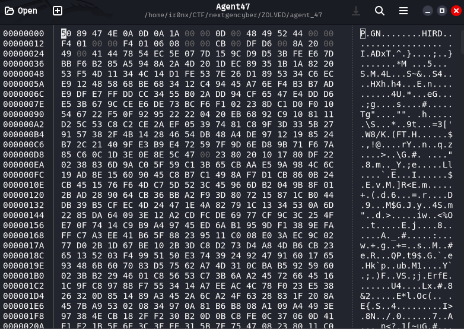
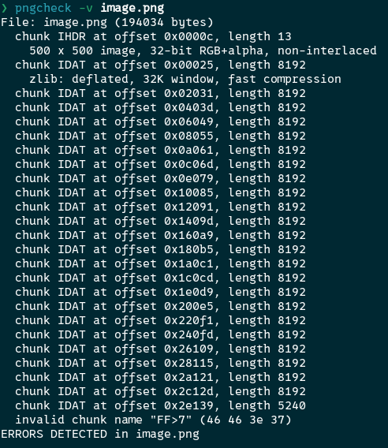
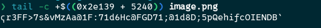
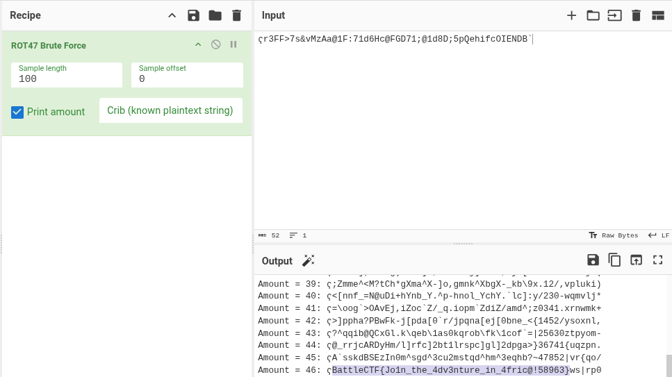

## Summary

Challenge **Agent 47** from the 2025-SADC-NextGenCyber-CTF CTF, forensics category.

## Statement and artefacts

See the original challenge files and images in this directory.

## Recognition signals

- (see resolution method below)

## Resolution method

# Agent 47



Running the file command on the file it returns “data”

By opening the file with ghex I’ve noticed that it is a .png file but the bytes pairs are swaped



For example the normal start should be: 89 50 4E 47….

So I wrote a python script who gets the bytes, put them in order and recover the image

```python
import re

def hexdump(data, length=16, sep=' '):

    if not isinstance(data, (bytes, bytearray)):
        raise TypeError("Input data must be un objet bytes-like (bytes ou bytearray).")

    lines = []
    for i in range(0, len(data), length):
        chunk = data[i:i + length]
        hex_repr = sep.join(f'{b:02x}' for b in chunk)
        ascii_repr = ''.join(chr(b) if 32 <= b < 127 else '.' for b in chunk)
        lines.append(f'{hex_repr:<{length * 3 - 1}}')

    return '\n'.join(lines)

def split_in_blocs(s, taille=3):
    return [s[i:i+taille] for i in range(0, len(s), taille)]    

def swap_pairs(hex_list):
    swapped = []
    for i in range(0, len(hex_list) - 1, 2):
        swapped.append(hex_list[i+1])
        swapped.append(hex_list[i])
    if len(hex_list) % 2 != 0:
        swapped.append(hex_list[-1])
    return swapped

file = "Agent47"

with open(file, "rb") as f:
	result = f.read()

res = hexdump(result)
res.split(" ")
clean = [re.sub(r'[^0-9A-Fa-f]', '', x) for x in res]
clean = "".join(clean)
clean = split_in_blocs(clean, 2)

correct_dump = swap_pairs(clean)
with open("image.png", "wb") as f:
    f.write(bytes.fromhex(' '.join(correct_dump)))

```

Here is the .png file we get 


I’ve run the command “pngcheck -v image.png” and got some results



There is chunk data from a offset

I extracted the chunk



**0x2e139** is the offset

**5240** is the lenght of the chunk

```
ҁr3FF>7s&vMzAa@1F:71d6Hc@FGD71;@1d8D;5pQehifcOIENDB`
```

I tried a rot47 brute force, looked in the results and found the flag



**FLAG:** SADC{Jo1n_the_4dv3nture_in_4fric@!58963}

## Flag

SADC{Jo1n_the_4dv3nture_in_4fric@!58963}

## Lessons and reusable patterns

- (see resolution method above)
