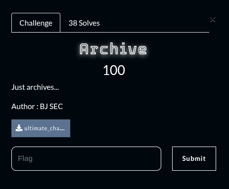
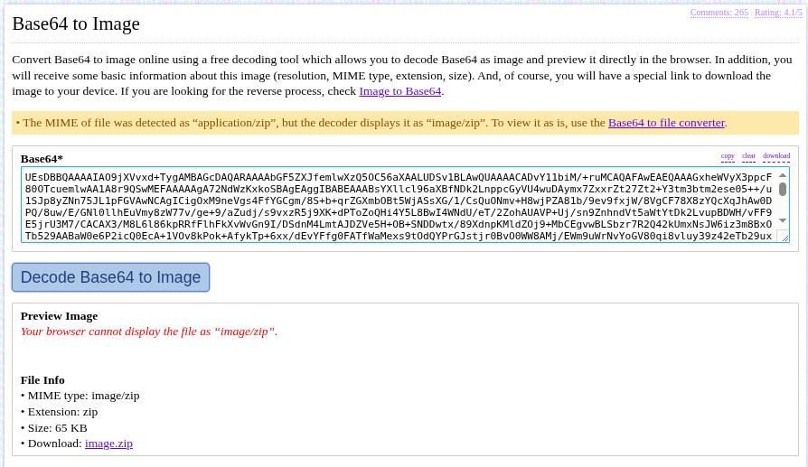
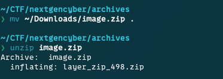
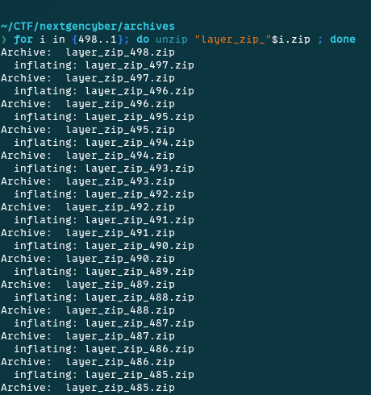
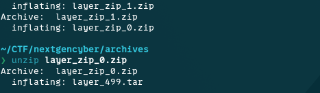
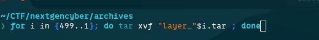
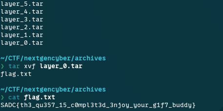

## Summary

Challenge **Archive** from the 2025-SADC-NextGenCyber-CTF CTF, forensics category.

## Statement and artefacts

See the original challenge files and images in this directory.

## Recognition signals

- (see resolution method below)

## Resolution method

# Archive

The content of the file looks like base64 and trying to decode it in the terminal doesnt give anything readable. I used a website to convert base64 content into a file

With the file downloaded, trying to unzip gives us this

The output says that the file have been ziped 499 times. So I used a loop to unzip it 

We can see now that the file have been archived 499 times.

 Loop again!!!

**FLAG:** SADC{th3_qu357_15_c0mpl3t3d_3njoy_your_g1f7_buddy}

## Flag

SADC{th3_qu357_15_c0mpl3t3d_3njoy_your_g1f7_buddy}

## Lessons and reusable patterns

- (see resolution method above)
