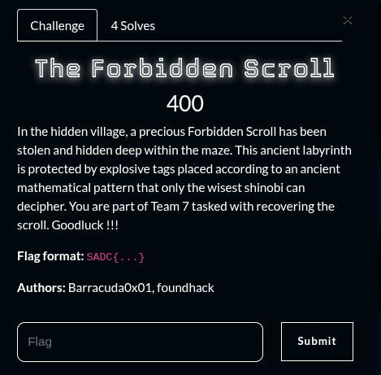
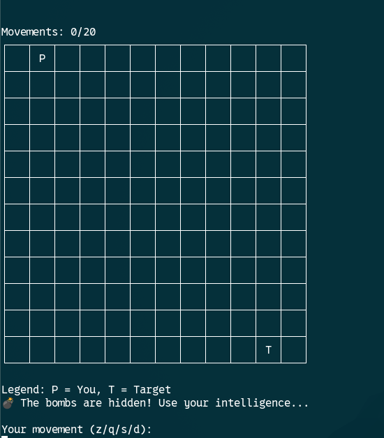
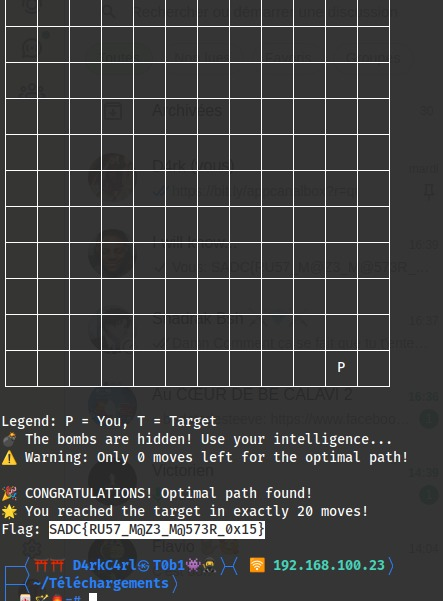
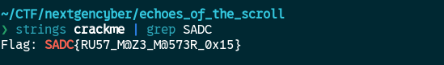
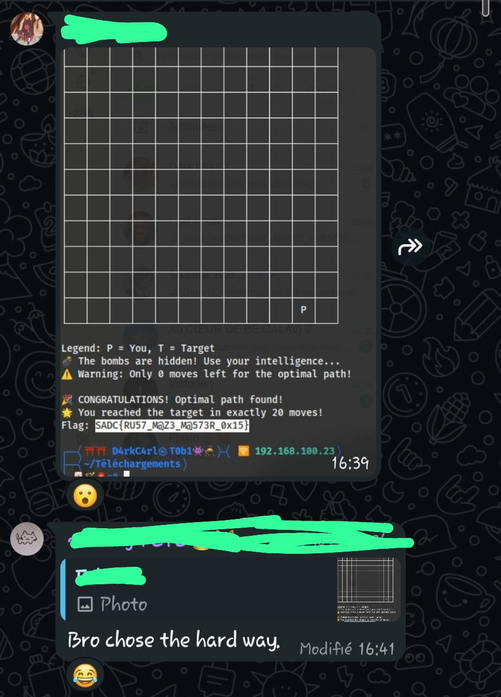

## Summary

Challenge **The Forbidden Scroll** from the 2025-SADC-NextGenCyber-CTF CTF, serie category.

## Statement and artefacts

See the original challenge files and images in this directory.

## Recognition signals

- (see resolution method below)

## Resolution method

# The Forbidden Scroll

This challenge is the next one from [Echoes of the scrolls](../Echoes-of-the-scrolls/writeup.md)

This says to use the crackme we found in the last chall to get the flag

By running the binary we get a game to play

One of my team members, [D4rkC4rl](https://github.com/Fabrice000) actually solved it by playing it

And another one [H42r1](https://github.com/H42r1) solved it by running the command strings on the binary

**FLAG**: SADC{RU57_M@Z3_M@573R_0x15}

## Flag

SADC{RU57_M@Z3_M@573R_0x15}

## Lessons and reusable patterns

- (see resolution method above)
