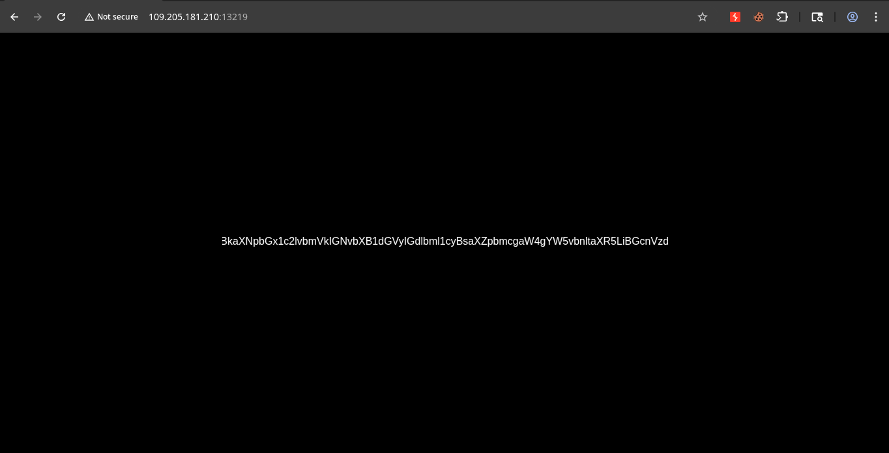
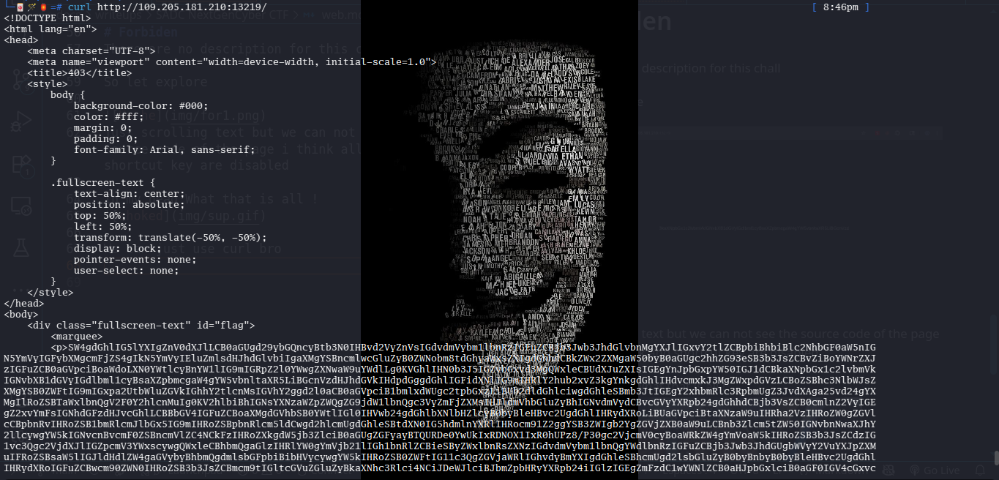
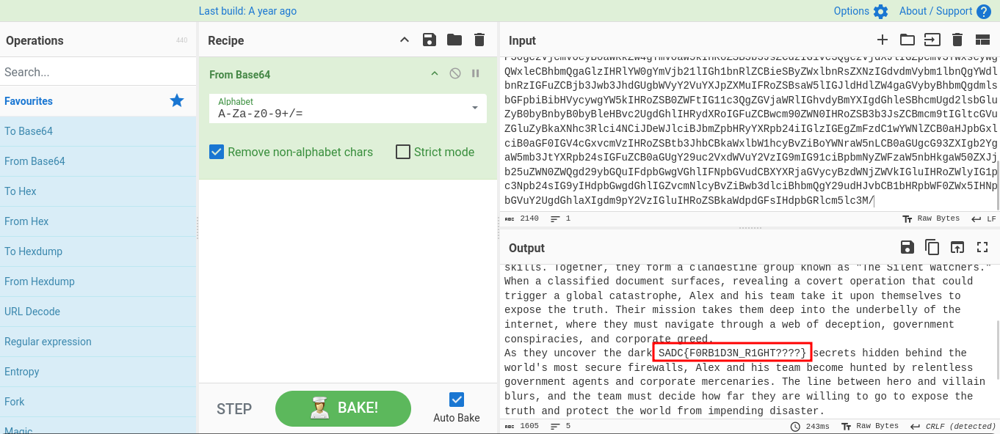

## Summary

Challenge **Forbiden** from the 2025-SADC-NextGenCyber-CTF CTF, web category.

## Statement and artefacts

See the original challenge files; provided artefacts are not copied.

## Recognition signals

- (see resolution method below)

## Resolution method

## Forbiden [100pts]

There are no description for this chall

So let explore

just scrolling text but we can not see the source code of the page i think all click and shortcut key are disabled

In my head:`What? that is all!??`

We can just use curl bro

An encoded text.Please come in rescue  [CyberChef](https://gchq.github.io/CyberChef/)

## Flag

Not specified

## Lessons and reusable patterns

- (see resolution method above)
