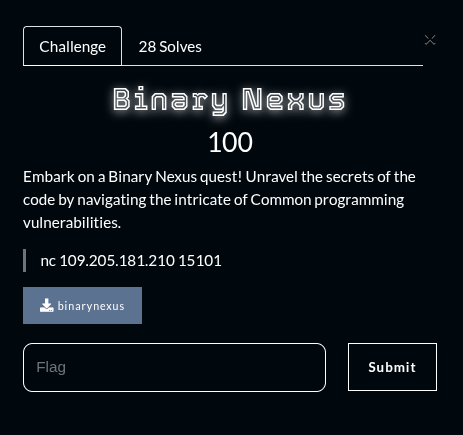
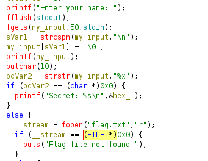
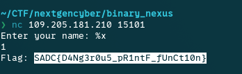

## Summary

Challenge **Binary nexus** from the 2025_SADC-NextGenCyber-CTF CTF, binary exploitation category.

## Statement and artefacts

See the original challenge files and images in this directory.

## Recognition signals

- (see resolution method below)

## Resolution method

# Binary nexus

I opened the binary with ghidra and here is the pseudo-code

By analysing the code we can se that if we give as input “%x” then the flag will be printed

**FLAG:** SADC{D4Ng3r0u5_pR1ntF_fUnCt10n}

## Flag

SADC{D4Ng3r0u5_pR1ntF_fUnCt10n}

## Lessons and reusable patterns

- (see resolution method above)
