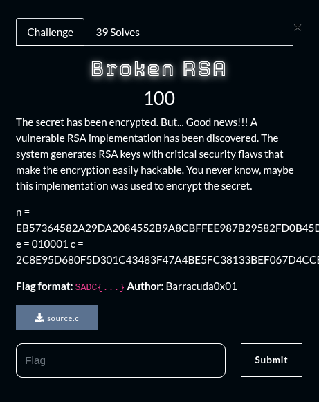
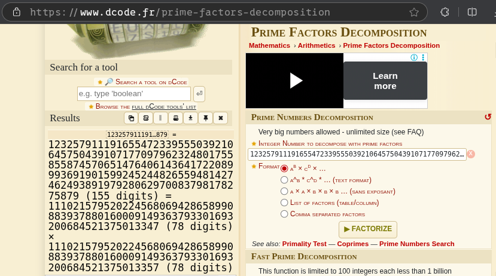

## Summary

Challenge **Broken RSA** from the 2025_SADC-NextGenCyber-CTF CTF, cryptography category.

## Statement and artefacts

See the original challenge files and images in this directory.

## Recognition signals

- (see resolution method below)

## Resolution method

# Broken RSA



```
n = "EB57364582A29DA2084552B9A8CBFFEE987B29582FD0B45DBBB5EDECE99556B1F4967344C8C65D041698B9AA3AF20F82A52D7B09CF7D8EDB533007225BFF2227"
e = 65537 #010001
c = "2C8E95D680F5D301C43483F47A4BE5FC38133BEF067D4CCB61D65BFAECCC170EDDFC985451BFE32FBA0144491A8EC0B0B21BB94C7AE8B97128C15956A51A0DD5"
```

I converted the n value into integer and went to  [https://www.dcode.fr/prime-factors-decomposition](https://www.dcode.fr/prime-factors-decomposition) to recover the two prime numbers 



And then wrote a python script to uncover the ciphertext

```python
n = "EB57364582A29DA2084552B9A8CBFFEE987B29582FD0B45DBBB5EDECE99556B1F4967344C8C65D041698B9AA3AF20F82A52D7B09CF7D8EDB533007225BFF2227"
e = 65537 #010001
c = "2C8E95D680F5D301C43483F47A4BE5FC38133BEF067D4CCB61D65BFAECCC170EDDFC985451BFE32FBA0144491A8EC0B0B21BB94C7AE8B97128C15956A51A0DD5"

n_int = int(n,16)
e_int = e
c_int = int(c,16)
##Factorize with https://www.dcode.fr/prime-factors-decomposition
p = 111021579520224568069428658990883937880160009149363793301693200684521375013347
q = 111021579520224568069428658990883937880160009149363793301693200684521375013357

phi_n = (p-1)*(q-1)           # Phi(n)
d_int = pow(e,-1,phi_n)       # Private key

flag = pow(c_int,d_int,n_int) # decode

print(hex(flag)[2:])
```

```python
534144437b4272306b336e5f5253415f463463743072795f4d34737433727d
```

We convert the hex output into text to get the flag

**FLAG:** SADC{Br0k3n_RSA_F4ct0ry_M4st3r}

## Flag

SADC{Br0k3n_RSA_F4ct0ry_M4st3r}

## Lessons and reusable patterns

- (see resolution method above)
