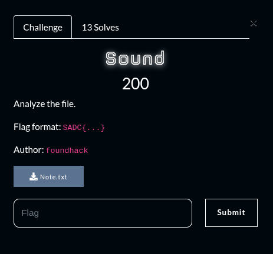
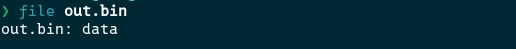
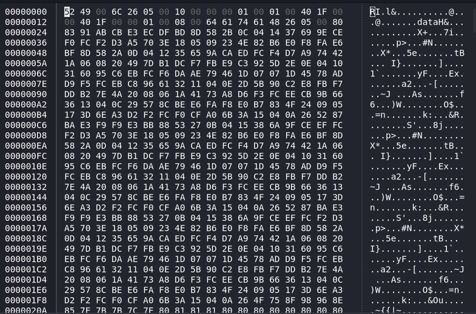
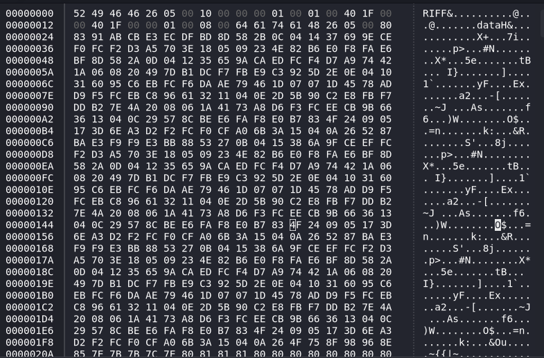

## Summary

Challenge **Sound** from the 2025_SADC-NextGenCyber-CTF CTF, forensics category.

## Statement and artefacts

See the original challenge files and images in this directory.

## Recognition signals

- (see resolution method below)

## Resolution method

# Sound



We are give this file for the challenge

[Note.txt](Sound/Note.txt)

The file is a hexdump. I wrote a python script to recover the file with the dump

```python
#!/usr/bin/env python3
import sys
import re

HEX_PAIR_RE = re.compile(r'[0-9A-Fa-f]{2}')
PLACEHOLDER_RE = re.compile(r'^[Xx❌\?]{2}$')

def process_token(tok, out, unknowns):
    tok = tok.strip()
    if not tok:
        return
    # enlever '0x' si présent et ponctuation autour
    if tok.lower().startswith('0x'):
        tok = tok[2:]
    tok = tok.strip(',:;|[]()<>')
    if not tok:
        return

    # cas simple : pair hex exacte
    if re.fullmatch(r'[0-9A-Fa-f]{2}', tok):
        out.append(int(tok, 16))
        return

    # placeholder exact (XX, ??, ❌❌)
    if PLACEHOLDER_RE.fullmatch(tok):
        out.append(0x00)
        unknowns.append(tok)
        return

    # extraction de toutes les paires hex à l'intérieur du token (ex: "5249" -> 52,49)
    pairs = HEX_PAIR_RE.findall(tok)
    if pairs:
        for p in pairs:
            out.append(int(p, 16))
        # si le token contenait aussi des morceaux non-hex, on les ignore ici
        return

    # token non reconnu -> remplacer par 0x00 (et noter)
    out.append(0x00)
    unknowns.append(tok)

def rebuild(input_path, output_path):
    out = bytearray()
    unknowns = []
    with open(input_path, 'r', encoding='utf-8', errors='ignore') as f:
        for line in f:
            # split sur espaces (suffisant pour la plupart des dumps)
            for tok in re.split(r'\s+', line.strip()):
                process_token(tok, out, unknowns)

    with open(output_path, 'wb') as w:
        w.write(out)

    print(f"Wrote {len(out)} bytes to {output_path}")
    if unknowns:
        print(f"Unknown tokens replaced by 0x00: {len(unknowns)} (exemples: {unknowns[:10]})")

if __name__ == '__main__':
    if len(sys.argv) < 3:
        print("Usage: python3 simple_rebuild.py dump.txt out.bin")
        sys.exit(1)
    rebuild(sys.argv[1], sys.argv[2])

```



The file is still not readable

I opened it with ghex to see if anything is recognizable



The start of the file looks like the header of an audio file

I searched on the web the file signature of and audo file and recovered it



By listening to the audio it looks it morse

So I decoded the morse code with an online tools and got the flag

FLAG: SADC{M0RS3_C0D3_!TRANSL4T0R@@WITH_4UD10_FE4TUR3512598648}

## Flag

SADC{M0RS3_C0D3_!TRANSL4T0R@@WITH_4UD10_FE4TUR3512598648}

## Lessons and reusable patterns

- (see resolution method above)
