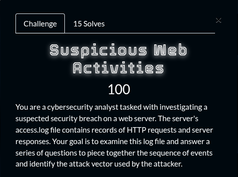

## Summary

Challenge **Suspicious Web Activities** from the 2025_SADC-NextGenCyber-CTF CTF, forensics category.

## Statement and artefacts

See the original challenge files and images in this directory.

## Recognition signals

- (see resolution method below)

## Resolution method

# Suspicious Web Activities



```
1. What is the IP address of the attacker?
2. What tool did the attacker use to scan for open ports and services?
3. What tool did the attacker use to search for endpoints on the web application?Format (tool/version)
4. What other exploitation tool did the attacker tried to use to exploit the application?Format (tool/version)
5. What endpoint did the other used to exploit the target? Format(/name/file)
6. What vulnerability did the attacker exploit to gain access to the target? Format(Name)
```

Flag format: `SADC{1_2_3_4_5_6}`

Here is the file we get from the challenge

[access.log](Suspicious%20Web%20Activities/access.log)

By analysing the log file here are the results

1. 141.44.201.11
2. nmap
3. gobuster/3.5
4. sqlmap/1.7.6
5. /cgi-bin/statsconfig
6. Shellshock

**FLAG:** SADC{141.44.201.11_nmap_gobuster/3.5_sqlmap/1.7.6_/cgi-bin/statsconfig_Shellshock}

## Flag

SADC{1_2_3_4_5_6}

## Lessons and reusable patterns

- (see resolution method above)
