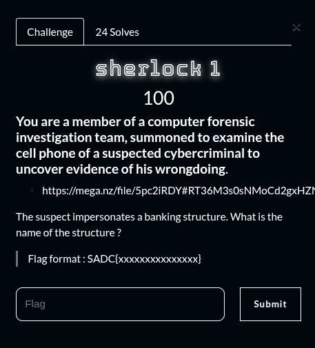
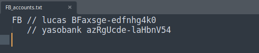

## Summary

Challenge **Sherlock 1** from the 2025_SADC-NextGenCyber-CTF CTF, mobile category.

## Statement and artefacts

See the original challenge files and images in this directory.

## Recognition signals

- (see resolution method below)

## Resolution method

# Sherlock 1



This challenge is the start of a series in this CTF. They was 8 challenge from Sherlock 1 to Sherlock 8

I’ve downloaded a phone dump with a lot of files

By searching the dump I found the answer to the first challenge to this path

```python
sherlock_1/data/media/0/Documents/FB_accounts.txt
```



**FLAG:** SADC{yasobank}

## Flag

SADC{yasobank}

## Lessons and reusable patterns

- (see resolution method above)
