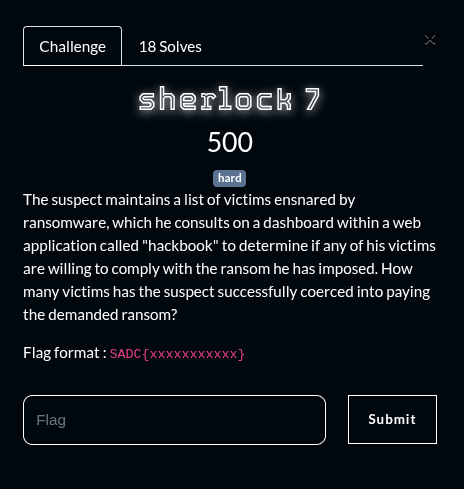
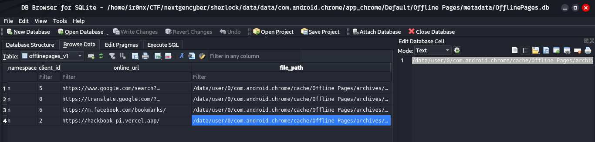
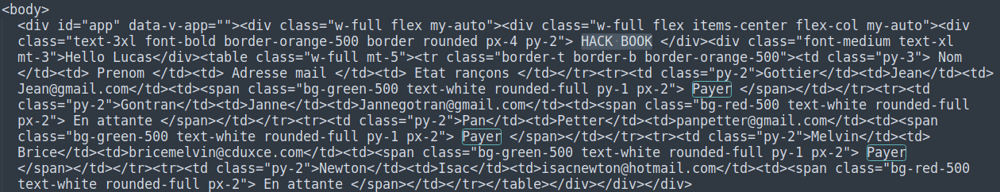

## Summary

Challenge **Sherlock 7** from the 2025_SADC-NextGenCyber-CTF CTF, mobile category.

## Statement and artefacts

See the original challenge files and images in this directory.

## Recognition signals

- (see resolution method below)

## Resolution method

# Sherlock 7



They say in the that the suspect consult his hackbook within a web app. So I went into the “data/data/com.android.chrome” path and by searching I found this database

```
data/data/com.android.chrome/app_chrome/Default/Offline Pages/metadata/OfflinePages.db
```

I found some offline url pages



And we can see the hackbook site mentioned in the challenge description

I got the path of the offline page


And opened it.



We can clearly see the “HACK BOOK” page the suspect browsered and we count that 3 people payed for his ransom

**FLAG:** SADC{3}

## Flag

SADC{3}

## Lessons and reusable patterns

- (see resolution method above)
