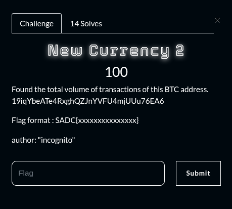
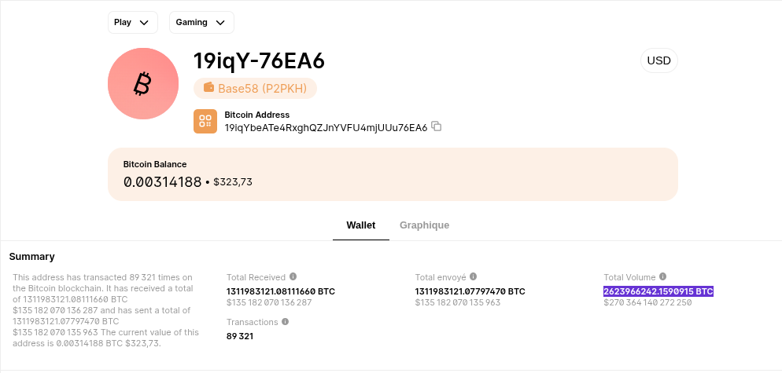

## Summary

Challenge **New currency 2** from the 2025_SADC-NextGenCyber-CTF CTF, osint category.

## Statement and artefacts

See the original challenge files and images in this directory.

## Recognition signals

- (see resolution method below)

## Resolution method

# New currency 2

I used the website [https://www.blockchain.com/fr/explorer](https://www.blockchain.com/fr/explorer) and paste the bitcoin adress

**FLAG:** SADC{2623966242.1590915}

## Flag

SADC{2623966242.1590915}

## Lessons and reusable patterns

- (see resolution method above)
