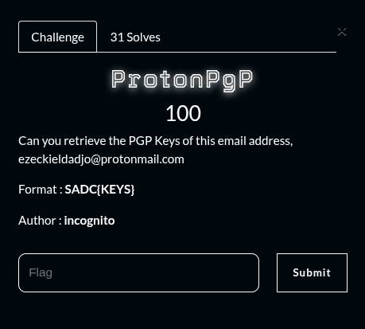
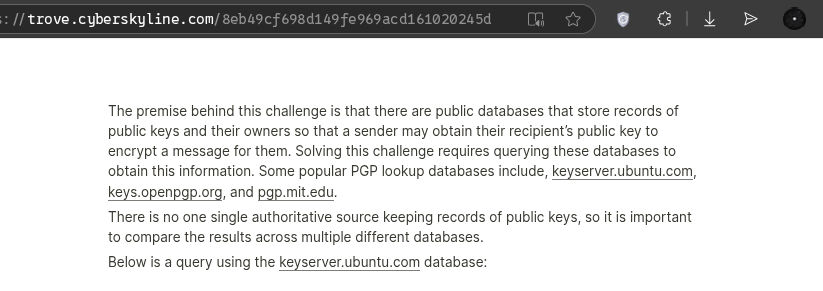
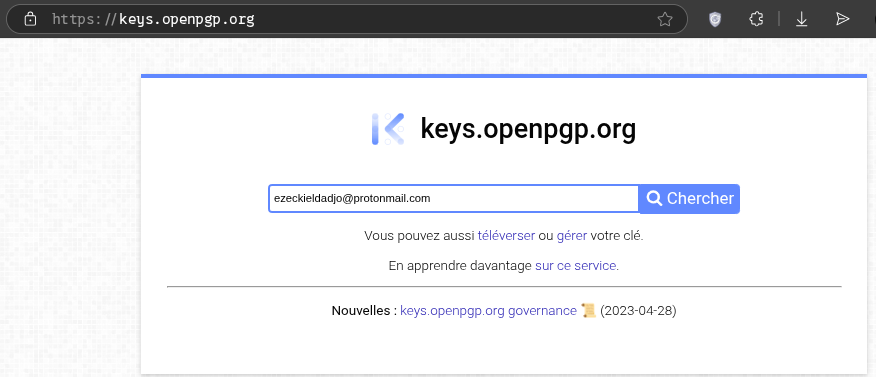
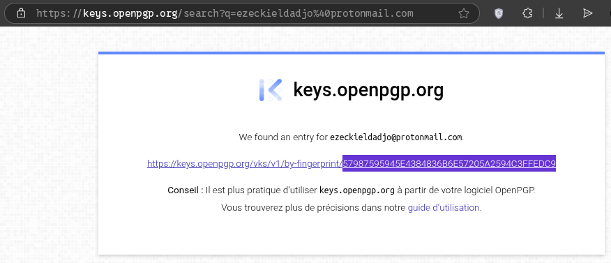

## Summary

Challenge **ProtonPgp** from the 2025_SADC-NextGenCyber-CTF CTF, osint category.

## Statement and artefacts

See the original challenge files and images in this directory.

## Recognition signals

- (see resolution method below)

## Resolution method

# ProtonPgp



```
ezeckieldadjo@protonmail.com
```

I’ve searched on google how to retrieve pgp keys



I’use the keys.openpgp.org



And found the key



**FLAG:** SADC{57987595945E4384836B6E57205A2594C3FFEDC9}

## Flag

SADC{57987595945E4384836B6E57205A2594C3FFEDC9}

## Lessons and reusable patterns

- (see resolution method above)
