## Summary

Challenge **Echoes of the Scroll** from the 2025_SADC-NextGenCyber-CTF CTF, serie category.

## Statement and artefacts

See the original challenge files and images in this directory.

## Recognition signals

- (see resolution method below)

## Resolution method

# Echoes of the Scroll

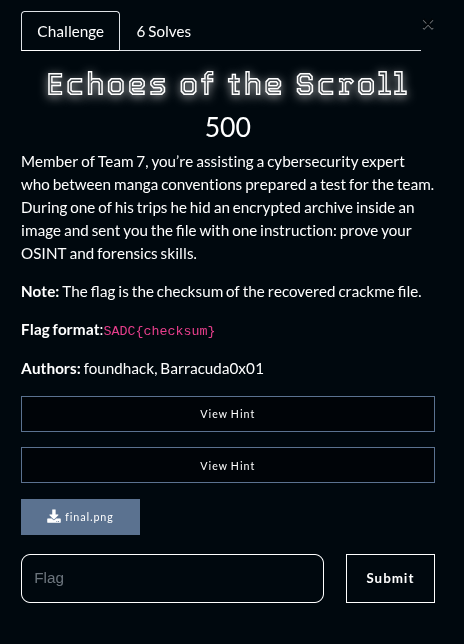

This image file is given for the challenge

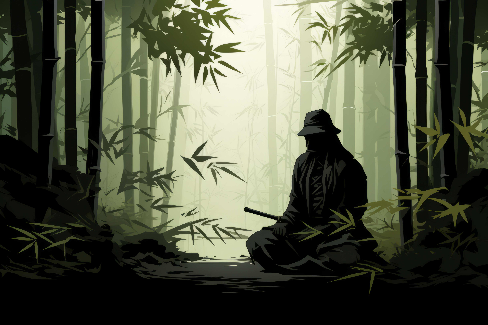

When running file on the image here is the output. 

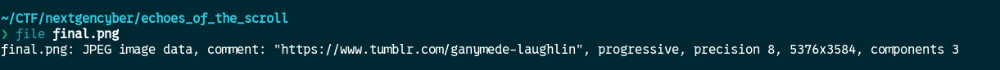

There is a [link](https://www.tumblr.com/ganymede-laughlin) so I opened it

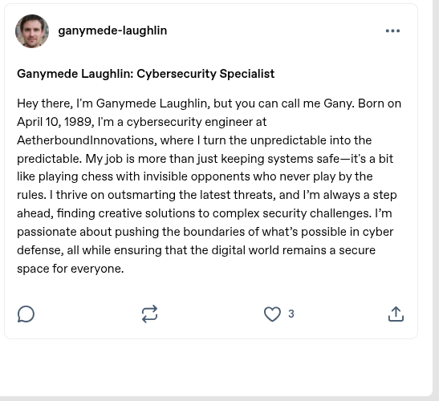

Here we get some informations about a guy named “**Ganymede Laughlin”** but for now I don’t know what to do with it. Let’s go back to the file

Running binwalk on the image we can see that there is a bunch of images inside of it

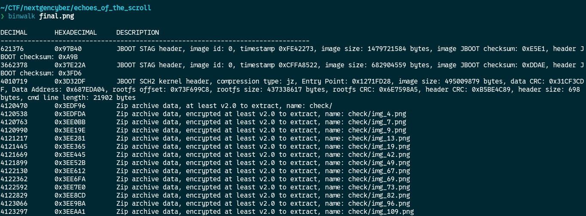

I extracted the content of the file with “foremost” and renamed it “final.zip”

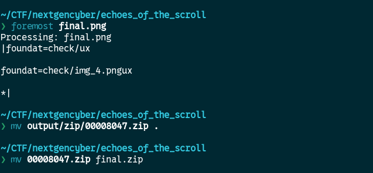

Trying to unzip it with “unzip” it says: unsuported compression method

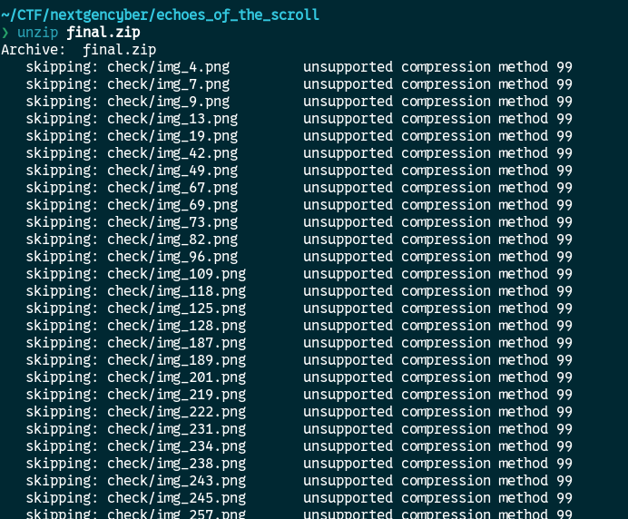

By looking over the web I found that this might have been encrypted with 7zip.

When I try to unzip it with 7zip, It prompt a password to be entered

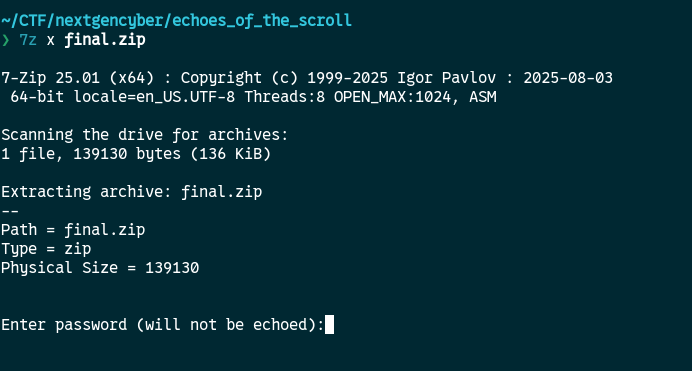

I don’t know any password and a blank password doesn’t work

In the challenge there is a hint about something called [CUPP](https://github.com/Mebus/cupp)

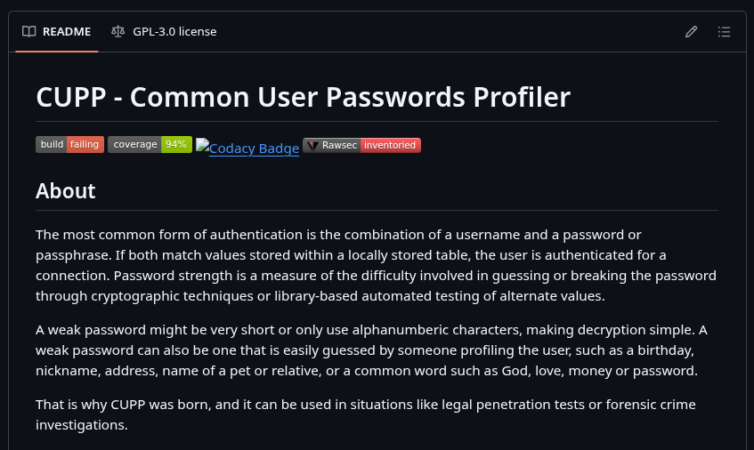

This tool generate a wordlist of password based of a person informations

I cloned the repo a ran the code with the informations I had

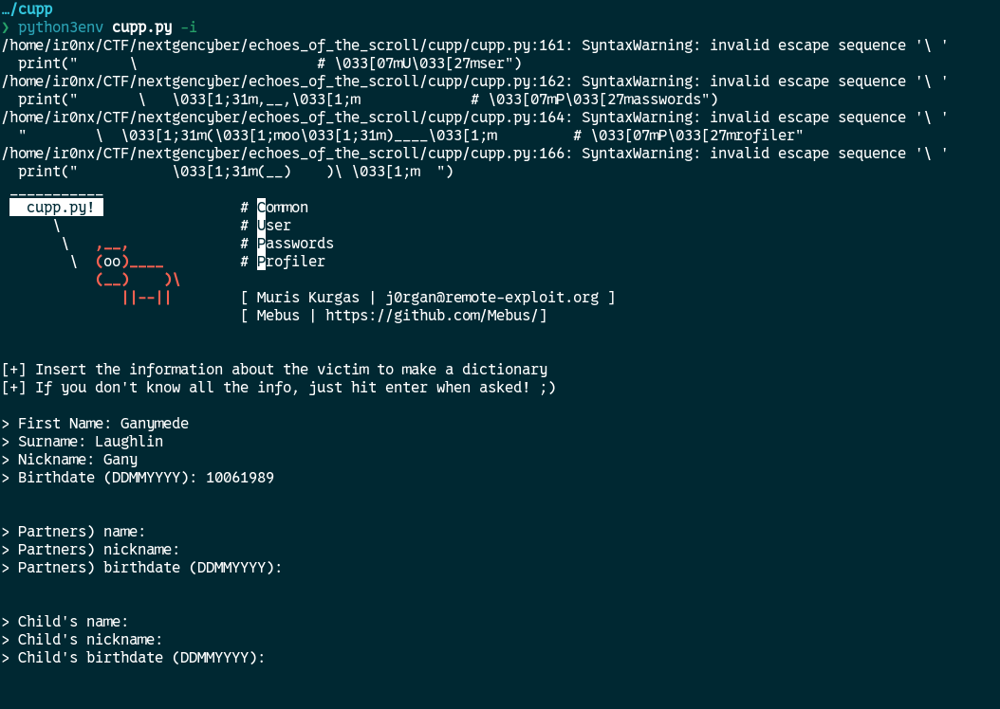

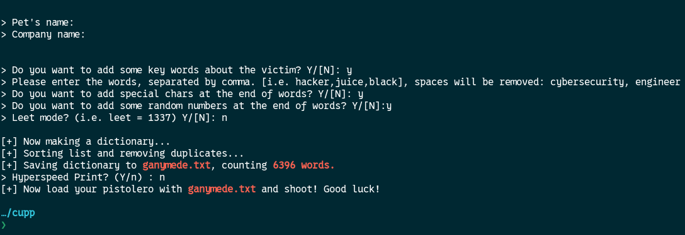

It used zip2john to extract the hashes and the wordlist generated to try to crack the hashes

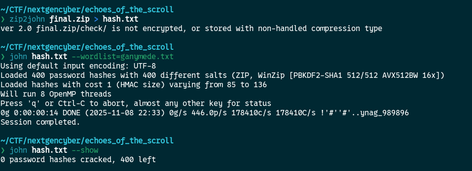

It did not worked. 

So from here I think we need to find more information about the guy profile earlier to generate a better wordlist with the CUPP script

I used sherlock to try to find some related links to his username

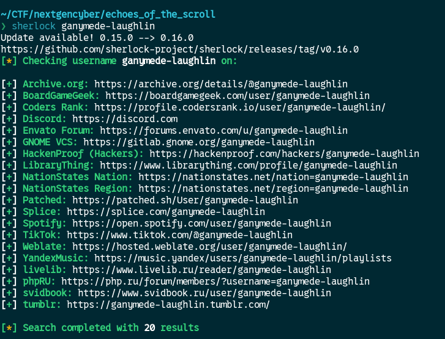

I’ve browsered throught every links with nothing new

We were stuck here for a while and almost at the end, one of the CTF’s maker gave us this informations

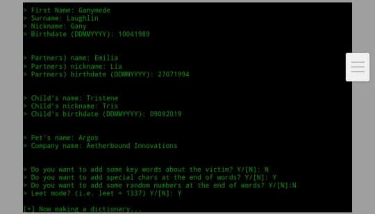

So I used it to make another dictionary

And used the new wordlist to try to crack the zip file this time.

But the generated wordlist still did not worked. When I reopened the file the CTF maker send to us I saw this

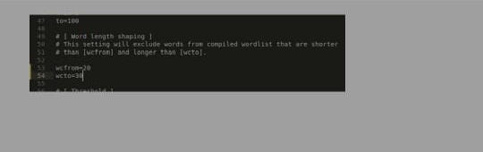

This is the content of the file “cup.cfg” from the CUPP script. This set the password lenght to be 20-30 characters long and that make sense because on the tumblr link we found earlier we had this

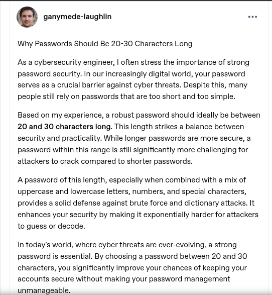

So this guy follow his own recommandation!

I changed the .cfg file too and regenerate the wordlist

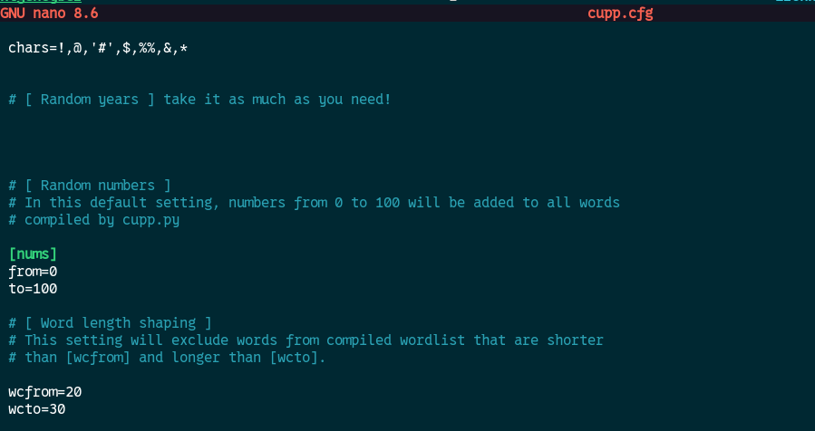

And launch the cracking process

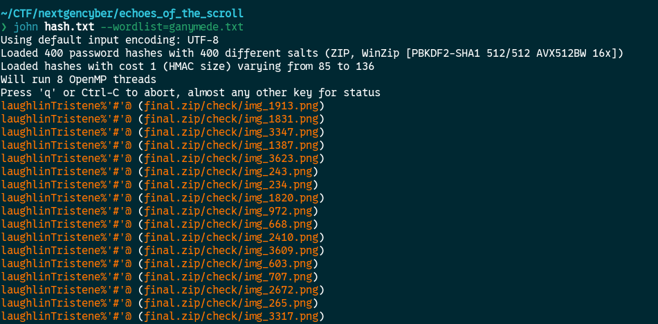

The password of the zip file is: **laughlinTristene%'#'@**

Now time to unzip it

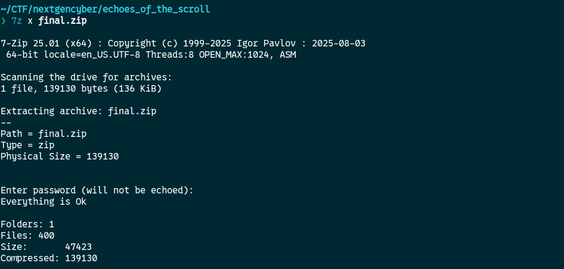

Files unziped sucessfully!

This are the images extracted from the zip we cracked

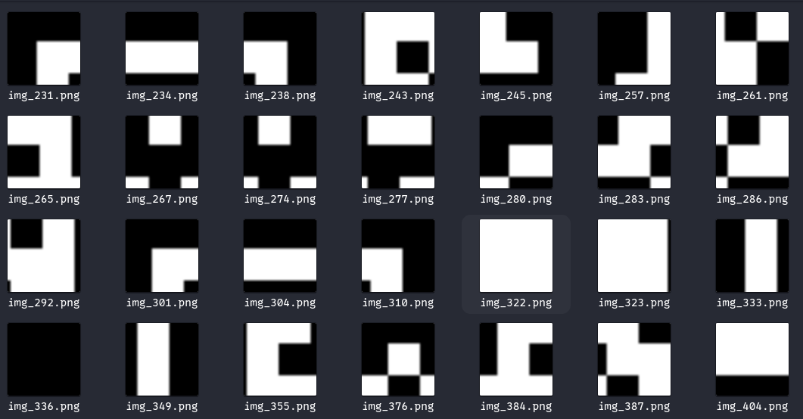

It looks like a qrcode

With the help of chatgpt I wrote a python script to recover the qrcode

```python
from PIL import Image
import os
import math

# Image file path
folder = "check"  # <-- to modify

files = sorted(
    [f for f in os.listdir(folder) if f.endswith(".png")],
    key=lambda x: int(''.join(filter(str.isdigit, x))) 
)

# Get every png files
tiles = [Image.open(os.path.join(folder, f)) for f in files]

w, h = tiles[0].size

n = int(math.sqrt(len(tiles)))

final_img = Image.new('RGB', (w * n, h * n), color=(255, 255, 255))

for i, tile in enumerate(tiles):
    x = (i % n) * w
    y = (i // n) * h
    final_img.paste(tile, (x, y))

final_img.save("qr_reconstructed.png")
print("✅ QR code recovered : qr_reconstructed.png")

```

Here is the qrcode

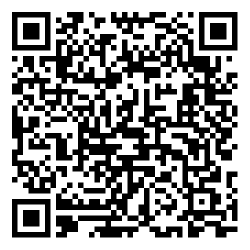

I’ve extracted a link from the qrcode.

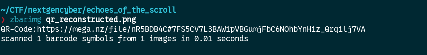

And head to it

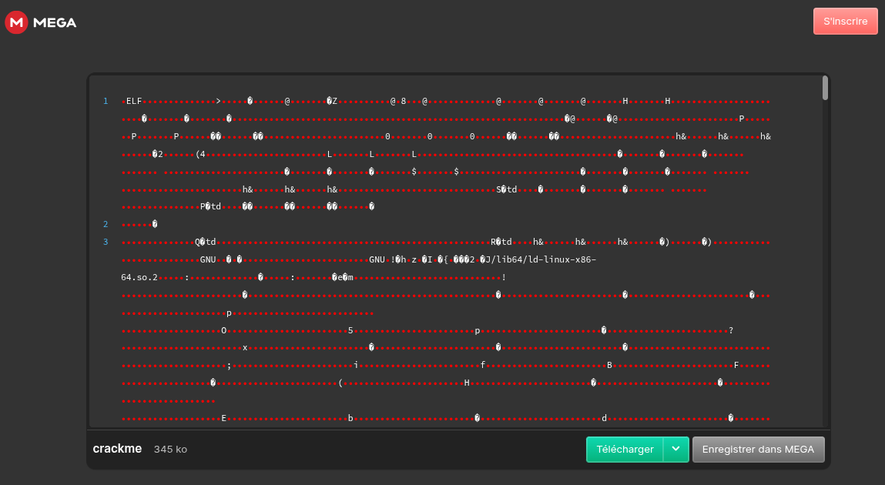

The answer to the challenge is the sha256 sum of the crackme file

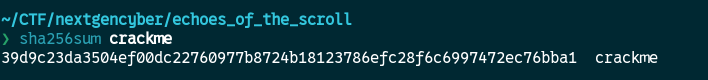

**FLAG:** SADC{39d9c23da3504ef00dc22760977b8724b18123786efc28f6c6997472ec76bba1}

This was a long run!

## Flag

Not specified

## Lessons and reusable patterns

- (see resolution method above)
