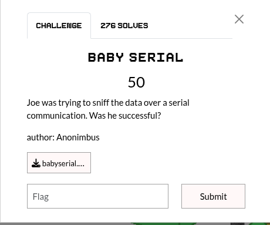
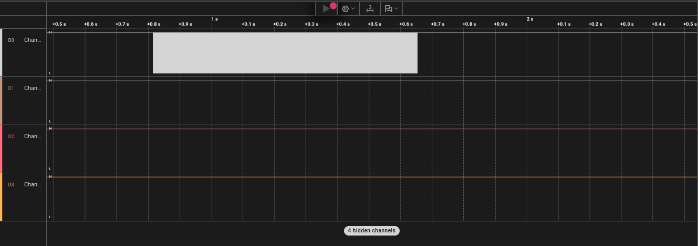
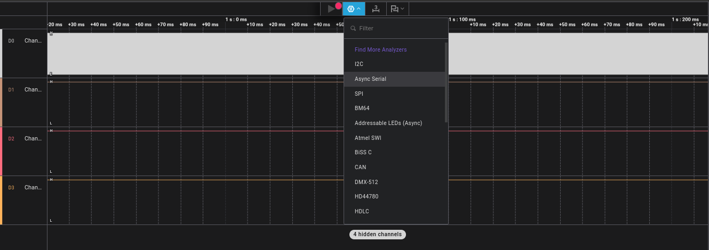
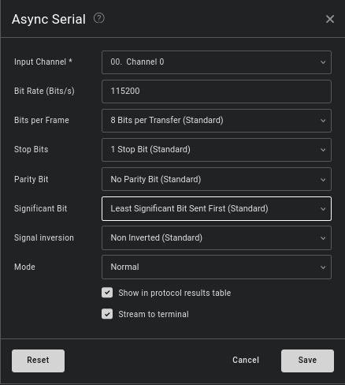
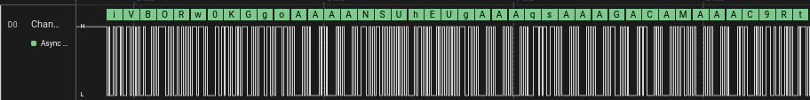
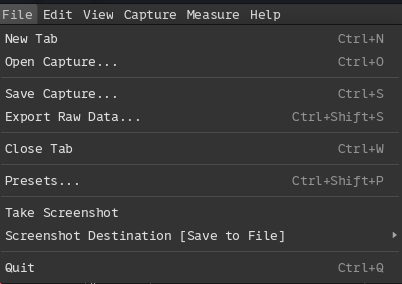
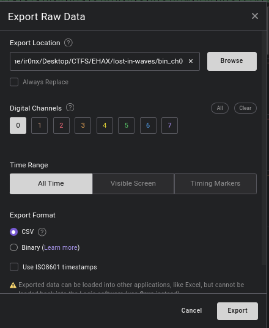
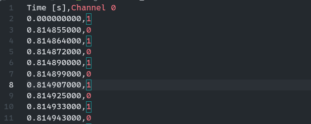

## Summary

Challenge **BABY SERIAL** from the 2026-EHAX-CTF CTF, forensics category.

## Statement and artefacts

See the original challenge files and images in this directory.

## Recognition signals

- (see resolution method below)

## Resolution method

# BABY SERIAL



For this challenge is given a .sal file.

After google searching, I found a software named Saleae Logic 2 to open it:



From this image we can see that only the channel “D0” has data

Let’s add the ‘Async Serial’ analyzer





This looks like base64 but the fact it’s very long makes me thinks it’s a file 



Let’s export the data in csv format





The csv file should look like this



Now I wrote a python script to read the csv file and put the file together

```python
import csv
import base64

INPUT = "bin_ch0/digital.csv"

BAUD = 115200
BIT_TIME = 1 / BAUD

edges = []
with open(INPUT) as f:
    r = csv.reader(f)
    next(r)
    for row in r:
        t = float(row[0])
        v = int(row[1])
        edges.append((t, v))

bits = []

for i in range(len(edges)-1):
    t, v = edges[i]
    t2, _ = edges[i+1]

    duration = t2 - t
    count = round(duration / BIT_TIME)

    bits.extend([v] * count)

# UART decode
bytes_out = []
i = 0

while i < len(bits) - 10:

    if bits[i] == 0:  # start bit

        data = bits[i+1:i+9]

        value = 0
        for b in range(8):
            value |= data[b] << b

        bytes_out.append(value)

        i += 10
    else:
        i += 1

data = bytes(bytes_out)

print("Recovered bytes:", len(data))

# sauver brut
with open("serial.bin", "wb") as f:
    f.write(data)

try:
    txt = data.decode()
    print("ASCII preview:")
    print(txt[:200])

    if "iVBOR" in txt:
        print("Base64 PNG détecté")

        b64 = txt.split("iVBOR",1)[1]
        b64 = "iVBOR" + b64

        img = base64.b64decode(b64)

        with open("flag.png", "wb") as f:
            f.write(img)

        print("Image sauvée → flag.png")

except:
    pass
```

**FLAG:** 


## Flag

Not specified

## Lessons and reusable patterns

- (see resolution method above)
