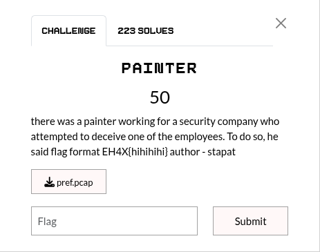
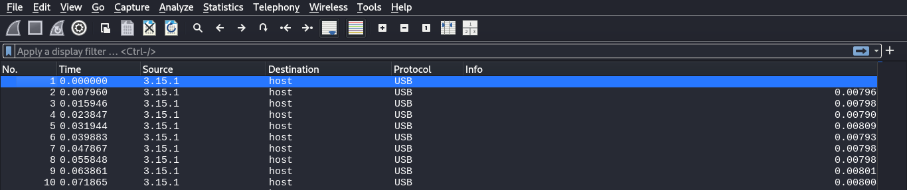
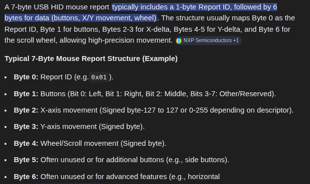
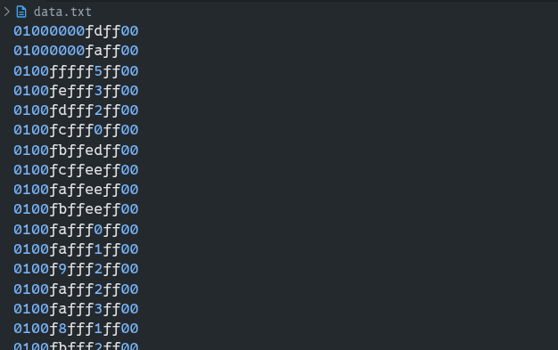
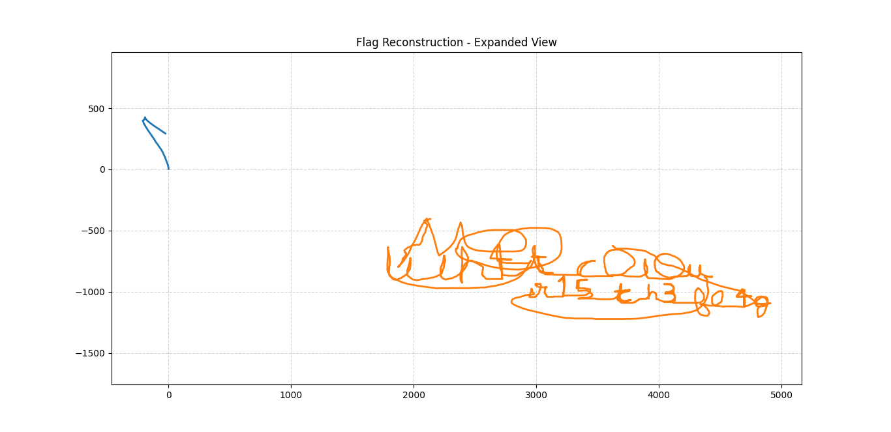

## Summary

Challenge **PAINTER** from the 2026-EHAX-CTF CTF, forensics category.

## Statement and artefacts

See the original challenge files and images in this directory.

## Recognition signals

- (see resolution method below)

## Resolution method

# PAINTER



For this challenge is given a .pcap file.

Opening it in wireshark show that it’s a capture of USB protocol



Now by looking around google and AI help I found something called “7-byte mouse report”



First I extracted the mouses data with:

```python
tshark -r pref.pcap -T fields -e usb.capdata > data.txt
```

Here is an overview of the file:



And wrote a python script to recover the mouse path 

[solve.py](scripts/solve.py)

That gave this image:



**FLAG:** EH4X{wh4t_c0l0ur_15_th3_fl4g}

## Flag

EH4X{wh4t_c0l0ur_15_th3_fl4g}

## Lessons and reusable patterns

- (see resolution method above)
