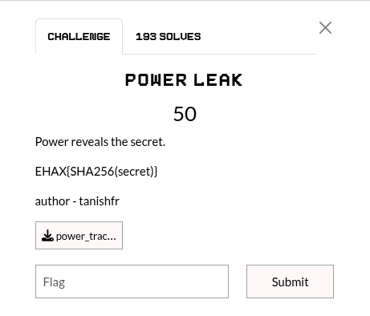
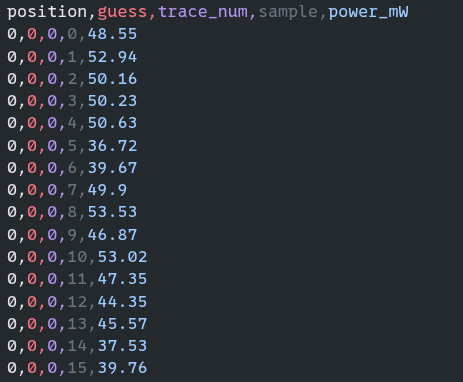

## Summary

Challenge **POWER LEAK** from the 2026-EHAX-CTF CTF, forensics category.

## Statement and artefacts

See the original challenge files and images in this directory.

## Recognition signals

- (see resolution method below)

## Resolution method

# POWER LEAK



The start of the .csv file given for the chall



Script to find the highest numbers

```python
import pandas as pd

# Chargement des données
df = pd.read_csv('power_traces.csv')

def recover_secret(df):
    secret_elements = []
    # On identifie toutes les positions présentes dans le fichier (0, 1, 2...)
    positions = sorted(df['position'].unique())
    
    print(f"Extraction du secret ({len(positions)} positions détectées)...")
    
    for pos in positions:
        # 1. Isoler la position
        data_pos = df[df['position'] == pos]
        
        # 2. Calculer la moyenne par (guess, sample) pour lisser le bruit
        # On cherche le point de consommation maximale pour chaque guess
        results = data_pos.groupby(['guess', 'sample'])['power_mW'].mean().reset_index()
        
        # 3. Trouver le guess qui possède le pic absolu le plus élevé
        best_match = results.loc[results['power_mW'].idxmax()]
        
        guess_value = int(best_match['guess'])
        max_power = best_match['power_mW']
        
        secret_elements.append(guess_value)
        print(f"Position {pos:2} : Guess {guess_value:3} ({max_power:.2f} mW)")

    # Affichage des résultats
    print("\n--- RÉSULTAT FINAL ---")
    secret = []
    for c in secret_elements:
        secret.append(str(c))
    print(f"Final secret : {"".join(secret)}")

recover_secret(df)
```

And the compute the sha256 of the secret

**FLAG:** EHAX{5bec84ad039e23fcd51d331e662e27be15542ca83fd8ef4d6c5e5a8ad614a54d}

## Flag

Not specified

## Lessons and reusable patterns

- (see resolution method above)
