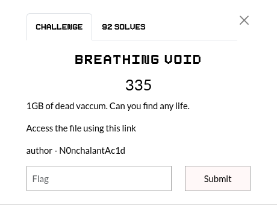

## Summary

Challenge **BREATHING VOID** from the 2026-EHAX-CTF CTF, misc category.

## Statement and artefacts

See the original challenge files and images in this directory.

## Recognition signals

- (see resolution method below)

## Resolution method

# BREATHING VOID



Here we are given a .pcap file of 1gb size. Opening it in wireshark transformed my PC in a jet engine.

With this command we get some interesting results

```python
capsinfo Breathing_Void.pcap
```


3 files have been merged to form this dump. The third file is what we are looking for. 

We can see that for the interface 2 we get 272 packets. This should be our file.

With this command we can extract the traffic capture on the interface #2

```python
tshark -r Breathing_Void.pcap -Y "frame.interface_id==2" -w covert_only.pcap
```

The new file looks like this in wireshark


But here there is something interesting. The time looks too much precise. Usually it’s not that much precise. So I extracted the timestamp difference between two consecutives packets to see what it look like with:

```python
tshark -r covert_only.pcap -T fields -e frame.time_delta > times.txt
```

Here start of the content of time.txt


We can see that we get only two distinct values. Let’s consider one of them as 0 and the other one as 1, extract the list of 0 and 1, cut it into 8 bits and convert in text.

But by doing so it doesn’t give the flag.

The answer to this is that the flag start after the first 7 bits and we have to remove then to have the right bits of our flag.

Here is my script to brute force all possible combination the flag could have been sent and offset transitions

```python
import sys

def bits_to_string_extended(bit_string, bit_size, offset=0, reverse_bits=False):
    data = bit_string[offset:]
    result = ""
    for i in range(0, len(data), bit_size):
        chunk = data[i:i+bit_size]
        if len(chunk) == bit_size:
            if reverse_bits:
                chunk = chunk[::-1]
            try:
                val = int(chunk, 2)
                if bit_size in [7, 8] and 32 <= val <= 126:
                    result += chr(val)
                else:
                    result += "."
            except:
                result += "?"
    return result

def solve_final_push(filename):
    with open(filename, 'r') as f:
        times = [float(l.strip()) for l in f if l.strip() and not l.startswith('#')]

    # Les deux logiques
    b_a = "".join(["1" if t < 0.05 else "0" for t in times])
    b_b = "".join(["0" if t < 0.05 else "1" for t in times])

    configs = [
        ("Normal A", b_a), ("Normal B", b_b),
        ("Inverse A", b_a[::-1]), ("Inverse B", b_b[::-1])
    ]

    print(f"{'VARIANTE':<15} | {'SZ':<2} | {'OFF':<2} | {'REV':<3} | {'RÉSULTAT'}")
    print("-" * 80)

    for label, b_str in configs:
        for size in [7, 8]:
            for off in range(size):
                for rev in [False, True]:
                    res = bits_to_string_extended(b_str, size, off, rev)
                    # On cherche des mots clés ou des structures de flag
                    if any(x in res.upper() for x in ["EH", "{", "}"]):
                        mark = "[!!!] "
                        print(f"{mark}{label:<10} | {size:<2} | {off:<2} | {str(rev):<3} | {res}")

solve_final_push("times.txt")
```

This script gives this output:


Here is the script that gives the flag:

```python
def solve_final_pcap(filename):
    with open(filename, 'r') as f:
        times = [float(l.strip()) for l in f if l.strip()]

    # 0.01s -> '0'
    # 0.10s -> '1'
    all_bits = "".join(["0" if t < 0.05 else "1" for t in times])
    

    # REMOVE THE FIRST 7 BITS
    useful_bits = all_bits[7:]
    
    print("-" * 30)
    print(f"CHAÎNE DE BITS (avec offset 7) :")
    print("-" * 30)
    print(all_bits)
    print("\n" + "-" * 30)
    
    flag = ""
    print("DÉCODAGE PAR OCTETS :")
    print("-" * 30)
    
    for i in range(0, len(useful_bits), 8):
        byte_str = useful_bits[i:i+8]
        if len(byte_str) == 8:
            val = int(byte_str, 2)
            char = chr(val) if 32 <= val <= 126 else "."
            flag += char
            print(f"Bits: {byte_str} | Hex: {hex(val)} | Char: {char}")

    print("-" * 30)
    print(f"FLAG FINAL : {flag}")
    print("-" * 30)

if __name__ == "__main__":
    solve_final_pcap("times.txt")
```

**FLAG:** EH4X{pc@p5_@re_of+en_mo5+1y_noi5e}

## Flag

EH4X{pc@p5_@re_of+en_mo5+1y_noi5e}

## Lessons and reusable patterns

- (see resolution method above)
