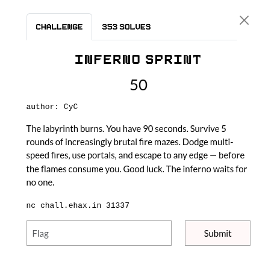

## Summary

Challenge **INFERNO SPRINT** from the 2026-EHAX-CTF CTF, misc category.

## Statement and artefacts

See the original challenge files and images in this directory.

## Recognition signals

- (see resolution method below)

## Resolution method

# INFERNO SPRINT



```python
from pwn import *
import binascii
from collections import deque

def solve():
    # Connexion au serveur
    r = remote('chall.ehax.in', 31337)

    for round_num in range(1, 6):
        log.info(f"Résolution du Round {round_num}/5")
        
        # On attend le début du round
        r.recvuntil(f"ROUND {round_num}/5".encode())
        
        # On cherche la ligne SIZE (en ignorant les lignes vides potentielles)
        line = r.recvline().decode()
        while "SIZE" not in line:
            line = r.recvline().decode()
            
        parts = line.strip().split()
        width, height = int(parts[1]), int(parts[2])
        
        # Lecture START
        line_start = r.recvline().decode().strip().split()
        start_y, start_x = int(line_start[1]), int(line_start[2])
        
        # Lecture LIMIT
        line_limit = r.recvline().decode().strip().split()
        move_limit = int(line_limit[1])

        # Lecture et décodage de la grille
        grid = []
        for _ in range(height):
            hex_row = r.recvline().strip().decode()
            ascii_row = binascii.unhexlify(hex_row).decode()
            grid.append(list(ascii_row))

        # --- 1. Simulation du feu ---
        fire_times = [[float('inf')] * width for _ in range(height)]
        fire_queue = deque()

        for y in range(height):
            for x in range(width):
                if grid[y][x] in '123':
                    speed = int(grid[y][x])
                    fire_times[y][x] = 0
                    # On ajoute (y, x, speed, time)
                    fire_queue.append((y, x, speed, 0))

        # Propagation BFS (on simule tour par tour)
        # Note: Dans ce challenge, la vitesse K signifie : avance de 1 case tous les K tours.
        # Donc une case (ny, nx) est brûlée au temps : T_actuel + K
        temp_queue = deque(fire_queue)
        while temp_queue:
            y, x, speed, time = temp_queue.popleft()
            for dy, dx in [(-1, 0), (1, 0), (0, -1), (0, 1)]:
                ny, nx = y + dy, x + dx
                if 0 <= ny < height and 0 <= nx < width and grid[ny][nx] != '#':
                    arrival = time + speed
                    if arrival < fire_times[ny][nx]:
                        fire_times[ny][nx] = arrival
                        temp_queue.append((ny, nx, speed, arrival))

        # --- 2. BFS Joueur ---
        portals = {}
        for y in range(height):
            for x in range(width):
                char = grid[y][x]
                if 'a' <= char <= 'e':
                    if char not in portals: portals[char] = []
                    portals[char].append((y, x))

        q = deque([(start_y, start_x, "", 0)])
        visited = set([(start_y, start_x, 0)])
        final_path = None

        while q:
            y, x, path, turns = q.popleft()

            # Condition de victoire (bord)
            if y == 0 or y == height - 1 or x == 0 or x == width - 1:
                final_path = path
                break
            
            if turns >= move_limit:
                continue

            # Mouvements ZQSD
            for dy, dx, char_move in [(-1,0,'W'), (1,0,'S'), (0,-1,'A'), (0,1,'D')]:
                ny, nx = y + dy, x + dx
                new_t = turns + 1
                if 0 <= ny < height and 0 <= nx < width:
                    if grid[ny][nx] != '#' and fire_times[ny][nx] > new_t:
                        if (ny, nx, new_t) not in visited:
                            visited.add((ny, nx, new_t))
                            q.append((ny, nx, path + char_move, new_t))

            # Action Portail
            char = grid[y][x]
            if 'a' <= char <= 'e':
                pair = [p for p in portals[char] if p != (y, x)][0]
                ny, nx = pair
                new_t = turns + 1
                if fire_times[ny][nx] > new_t:
                    if (ny, nx, new_t) not in visited:
                        visited.add((ny, nx, new_t))
                        q.append((ny, nx, path + 'P', new_t))

        if final_path:
            log.success(f"Path: {final_path}")
            r.sendline(final_path.encode())
        else:
            log.error("Échec : Aucun chemin trouvé.")
            break

    r.interactive()

if __name__ == "__main__":
    solve()
```

**FLAG:** EH4X{1nf3rn0_spr1n7_bl4z3_runn3r_m4573r}

## Flag

EH4X{1nf3rn0_spr1n7_bl4z3_runn3r_m4573r}

## Lessons and reusable patterns

- (see resolution method above)
